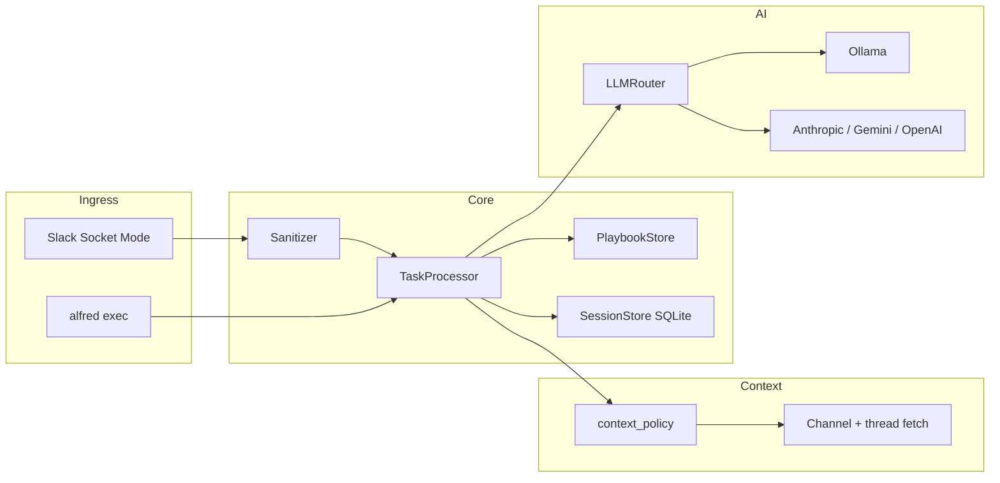

# Alfred

**Alfred** is a local-first AI assistant for small teams. Install it once, connect Slack and your AI provider, and `@alfred` answers in thread — with per-conversation memory, channel history context, and **Markdown playbooks** for company-specific rules (no custom Python per domain).

Built for companies that want a distributable agent (not a SaaS): config + encrypted secrets in `.alfred/`, optional Ollama on your machine, and a web admin UI for setup.

> **Status:** Alpha — Slack ingress, session memory, pluggable AI, and playbooks are working. Git/AWS tools, ReAct agent loop, and full skills engine are planned. See [implementation tracker](docs/build-reference/building_phase_v0.md).

**Requires Python 3.10+.** Local development targets **Python 3.13** (see `.python-version`). macOS system `python3` is often 3.9 and will not work.

---

## What Alfred does today

| Capability | Description |
|------------|-------------|
| **Slack `@alfred` mentions** | Socket Mode ingress — no public URL required. Replies stay in the thread. |
| **Thinking indicator** | Native Slack Assistant status (`assistant.threads.setStatus`) when Agents & AI Apps is enabled. |
| **Per-thread memory** | SQLite session store — follow-up questions in the same thread keep context. |
| **Channel + thread history** | Fetches Slack messages (default **30-day** window) with reaction display names. |
| **Domain playbooks** | `.alfred/playbooks/*.md` — YAML triggers + instructions injected into the model (your formatting, field mapping, completeness rules). |
| **Pluggable AI** | Ollama (default), OpenAI-compatible APIs, Anthropic, Gemini — switch via config. |
| **Admin UI** | Secrets, integrations, AI settings, health checks, Ollama setup wizard. |
| **CLI** | `alfred exec "question"` — same processing path as Slack, without posting. |

### Not built yet (see roadmap)

- ReAct agent loop and tool registry (git grep, read_file, AWS read, etc.)
- Full **skills** engine with BM25 matching and `allowed_tools` enforcement
- Thread relevancy ranking (stack traces, PR links, recency)
- Git webhook ingress and durable task queue

Details: [`docs/build-reference/building_phase_v0.md`](docs/build-reference/building_phase_v0.md)

---

## Architecture (high level)



**Design principles** (from [`docs/build-reference/v0.md`](docs/build-reference/v0.md)):

- **Local-first** — data in `.alfred/`, default AI via Ollama
- **Generic core** — no company-specific parsers in Python; domain rules live in playbooks
- **Pluggable AI** — one config key changes provider/model
- **Governed execution** (planned) — skills define *what*; tools define *how*

---

## Quick start

### One-shot setup (recommended)

```bash
chmod +x scripts/*.sh
./scripts/setup.sh
```

Creates `.venv` with Python 3.13, installs `alfred-agent[ai,dev]`, runs `alfred init`, seeds `.alfred/playbooks/`.

### Run locally

**Terminal 1 — API + Slack listener:**

```bash
./scripts/dev.sh
# or: source .venv/bin/activate && alfred serve --reload
```

**Terminal 2 — Admin UI (dev):**

```bash
cd frontend && npm install && npm run dev
```

| Service | URL |
|---------|-----|
| Admin UI (dev) | http://127.0.0.1:5173 |
| API + bundled UI (serve) | http://127.0.0.1:8080 |
| Health | http://127.0.0.1:8080/api/health |

Get the admin token (needed to save secrets in the UI):

```bash
alfred token
```

Logs: `.alfred/alfred.log`

### Manual setup

```bash
python3.13 -m venv .venv
source .venv/bin/activate
pip install -e ".[ai,dev]"

cp .env.example .env   # optional
export ALFRED_DATA_DIR=$PWD/.alfred
alfred init
alfred serve --host 127.0.0.1 --port 8080
```

Apple Silicon Homebrew Python:

```bash
/opt/homebrew/bin/python3.13 -m venv .venv
```

### Docker

```bash
docker compose up --build
```

Open http://localhost:8080 — on first run Alfred auto-initializes; admin token appears in logs.

---

## Slack setup

Alfred uses **Socket Mode** (no Request URL). In [api.slack.com/apps](https://api.slack.com/apps):

1. Create app → enable **Socket Mode** → App-Level Token (`xapp-…`) with `connections:write`
2. **OAuth & Permissions** → Bot Token Scopes:
   `app_mentions:read`, `channels:history`, `channels:read`, `chat:write`, `groups:history`, `groups:read`, `users:read`, `assistant:write`
3. Enable **Agents & AI Apps** for native thinking status
4. **Event Subscriptions** → `app_mention`
5. Install app → copy **Bot Token** (`xoxb-…`) and **Signing Secret**
6. Paste all three tokens in Admin UI → **Secrets** → enable Slack → save (listener auto-restarts)
7. `/invite @Alfred` in a channel, then `@alfred …`

Optional: restrict channels in Integrations (`allowed_channels`).

---

## Domain playbooks

Company-specific instructions live in **Markdown**, not Python:

```
.alfred/playbooks/
  slack-summaries.md    # seeded on alfred init (from docs/playbooks/example)
```

Example front matter:

```yaml
---
name: slack-summaries
triggers:
  - summarize
  - merchant
  - threshold
channels: []   # empty = all channels
---

# Your rules here
- Include every row in a code-block table
- Use only timestamps from Slack context
```

Docs: [`docs/playbooks/README.md`](docs/playbooks/README.md)

Shipped **skills** (future full engine) live in [`skills/`](skills/) — e.g. `investigate_bug.md` — tools not wired yet.

---

## CLI reference

| Command | Description |
|---------|-------------|
| `alfred init` | Create `.alfred/`, config, encrypted secrets, example playbook |
| `alfred init --force` | Re-initialize (new admin token) |
| `alfred serve` | Start API, admin UI, Slack Socket Mode listener |
| `alfred serve --reload` | Dev auto-reload |
| `alfred status` | Data dir, init state, default AI provider, Slack readiness |
| `alfred token` | Print admin token for the UI |
| `alfred exec "…"` | Run a message through Alfred locally (no Slack post) |
| `alfred ollama setup` | Install, start, pull default Ollama model |
| `alfred ollama status` | Ollama install/runtime/model status |
| `alfred ollama install` | Install Ollama CLI |
| `alfred ollama start` | Start Ollama server |
| `alfred ollama pull --model llama3.2:3b` | Pull a model |

Global option: `--data-dir PATH` (default: `ALFRED_DATA_DIR` env, else `./.alfred` if initialized, else `~/.alfred`)

---

## Configuration

### Data directory (`.alfred/`)

| File | Purpose |
|------|---------|
| `config.yaml` | Non-secret settings (AI provider, Slack enabled, channels, server port) |
| `secrets.enc` | Encrypted tokens and API keys |
| `.key` | Local encryption key (mode 600) |
| `alfred.db` | Session memory (SQLite) |
| `alfred.log` | Runtime logs |
| `playbooks/` | Domain Markdown playbooks |

**Local dev:** use `./.alfred` in the repo (`scripts/env.sh` sets `ALFRED_DATA_DIR`). Avoid `alfred init` in `$HOME` unless intentional.

Clean duplicate state: `./scripts/clean-local.sh`

### Environment variables

See [`.env.example`](.env.example):

| Variable | Description |
|----------|-------------|
| `ALFRED_DATA_DIR` | Data directory path |
| `ALFRED_HOST` / `ALFRED_PORT` | Server bind (optional) |
| `ALFRED_ADMIN_TOKEN` | Pre-seed admin token (optional) |

Secrets are preferred via Admin UI → encrypted storage, not plain env.

---

## AI providers

Switch in Admin UI or `config.yaml` — no code changes.

| Provider | Config key | Install extra |
|----------|------------|---------------|
| **Ollama** (default, local) | `ollama` | `pip install alfred-agent[ai-openai]` |
| OpenAI / Groq / Together / etc. | `openai` | same (OpenAI-compatible API) |
| Anthropic Claude | `anthropic` | `pip install alfred-agent[ai-anthropic]` |
| Google Gemini | `gemini` | `pip install alfred-agent[ai-gemini]` |
| **Kimi** (Moonshot AI) | `kimi` | `pip install alfred-agent[ai-openai]` |

All providers: `pip install alfred-agent[ai]`

Recommended local model (M2 Air): `llama3.2:3b` or similar via Ollama.

---

## Admin UI

React + Vite app in [`frontend/`](frontend/):

| Tab | Purpose |
|-----|---------|
| **Home** | Overview, Ollama get-started |
| **AI** | Enable providers, models, default routing |
| **Secrets** | Slack, Git, AWS, API keys (encrypted) |
| **Integrations** | Toggle services, channel allowlists |
| **Health** | Connectivity checks (Slack ingress, AI, etc.) |

Dev: `cd frontend && npm run dev` (proxies API). Production: built into wheel / served by FastAPI from `frontend/dist`.

---

## Project layout

```
alfred/
├── backend/
│   ├── ai/                 # LLMProvider adapters + registry
│   ├── api/                # FastAPI routes (config, health, ollama)
│   ├── ingress/            # Slack context, processor, playbooks, prompts
│   ├── slack/              # Socket Mode listener, thinking status
│   ├── storage/            # SQLite session store
│   ├── ollama/             # Local Ollama install/start/pull helpers
│   ├── models/             # Pydantic config, Task, Session
│   ├── config_manager.py   # config.yaml + secrets.enc
│   └── cli.py              # alfred CLI entrypoint
├── frontend/               # React admin UI
├── skills/                 # Shipped skill templates (tools not wired yet)
├── docs/
│   ├── build-reference/    # Architecture (v0, idea, build tracker)
│   └── playbooks/          # Playbook format docs + example
├── tests/                  # pytest suite
├── scripts/                # setup.sh, dev.sh, clean-local.sh
├── docker/                 # Container entrypoint
├── Dockerfile
├── docker-compose.yml
└── pyproject.toml
```

---

## Development

### Tests

```bash
source .venv/bin/activate
uv run pytest tests/ -q
# or: pytest tests/ -q
```

### Lint

```bash
ruff check backend tests
```

### Production wheel

```bash
chmod +x scripts/build-release.sh
./scripts/build-release.sh
pip install dist/alfred_agent-*.whl
alfred init && alfred serve
```

---

## Documentation

| Document | Description |
|----------|-------------|
| [`docs/build-reference/v0.md`](docs/build-reference/v0.md) | Full layer architecture and build phases |
| [`docs/build-reference/idea.md`](docs/build-reference/idea.md) | Original blueprint (queue, skills, ReAct, governance) |
| [`docs/build-reference/building_phase_v0.md`](docs/build-reference/building_phase_v0.md) | **Implementation status & gaps** (living tracker) |
| [`docs/playbooks/README.md`](docs/playbooks/README.md) | How to write domain playbooks |
| [`docs/README.md`](docs/README.md) | Docs index |

HTML exports under `docs/build-reference/*.html` are local-only (gitignored).

---

## Example interactions

**Slack (in thread):**

```
@alfred can you summarize what happened in this channel last week?
@alfred when was the last alert posted and who reacted?
@alfred can you try again?
```

**CLI:**

```bash
alfred exec "who are you and what can you do?"
```

Responses use Slack formatting (bold, code blocks, fenced tables). Domain playbooks steer structure for your company's alert bots and fields.

---

## Roadmap (summary)

| Phase | Goal |
|-------|------|
| ✅ 0–1 | Foundation, config, pluggable AI |
| ✅ 3 | Slack `@alfred` ingress + thread replies |
| 🟡 2–4 | Playbooks (partial), context fetch (partial) |
| ❌ 5 | ReAct loop + read-only git investigation |
| ❌ 6–8 | Workflow skills, AWS tools, distribution polish |

Full gap list: [`building_phase_v0.md`](docs/build-reference/building_phase_v0.md)

---

## License

MIT — see [LICENSE](LICENSE).
