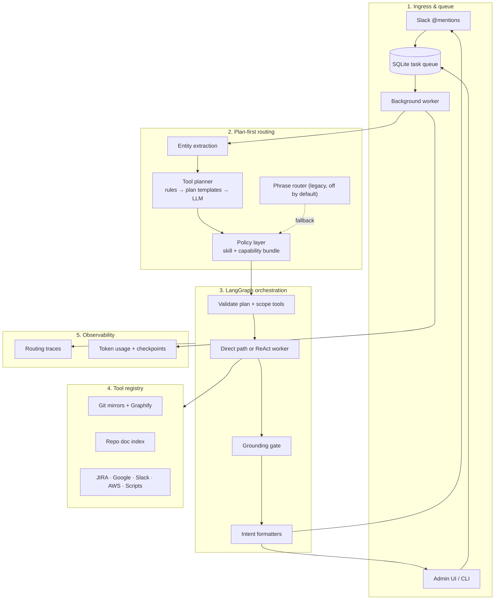

# Alfred

**Alfred** is a local-first AI assistant for engineering teams. Install once, connect Slack and your stack, mirror repos, and `@alfred` answers in thread — with session memory, git investigation, PR review, JIRA, **AWS (Athena + CloudWatch)**, and company-specific **playbooks**.

Config and encrypted secrets live in `.alfred/` (not a SaaS). Optional Ollama on your machine; admin UI for setup, health, and usage tracking.

> **Status:** Alpha — Slack ingress, durable SQLite task queue, unified routing, git/JIRA/AWS/Google investigation, schedules, planning mode, governance, and observability are working. **Next:** v2 automation (ECS/S3, hotfix skills); **v3** MCP + generic API extensibility (planned, not built). Slack DMs are out of scope.  
> **Tracker:** [`docs/build-reference/building_phase_v0.md`](docs/build-reference/building_phase_v0.md) (last reviewed 2026-07-18)

**Requires Python 3.10+.** Local dev targets **Python 3.13** (see `.python-version`).

---

## Table of contents

- [Capabilities](#capabilities)
- [Not built yet](#not-built-yet)
- [Quick start](#quick-start)
- [Setup guide](#setup-guide)
- [AWS integration](#aws-integration)
- [Slack app](#slack-app)
- [CLI reference](#cli-reference)
- [Configuration](#configuration)
- [Project structure](#project-structure)
- [Architecture](#architecture)
- [Skills vs playbooks](#skills-vs-playbooks)
- [Example interactions](#example-interactions)
- [Deploy on AWS](#deploy-on-aws-hosting-alfred)
- [Development](#development)
- [Documentation](#documentation)

---

## Capabilities

| Area | What works |
|------|------------|
| **Slack `@alfred`** | Socket Mode in **channels** only (not app DM window). Thinking status + custom emoji lines. |
| **Session memory** | SQLite per `(channel, thread)` — follow-ups, active PR, last git action. |
| **Slack context** | Channel + thread history (~90 days with dynamic day/week queries), reaction display names, Slack Lists parsing. |
| **Git investigation** | Mirror repos; `grep_repo`, `read_file`, `git_log`, `git_blame`, `git_show`. |
| **Git write (Phase 1)** | Opt-in (`git.write_enabled`): isolated branch, `write_file`, read-only debug scripts, draft PR via `create_pr` skill. |
| **PR review** | Summarize/review from URL or thread; GitHub App `@alfred review` on PR comments (optional, needs public URL). |
| **JIRA** | Search, get, update, comment, create, link PRs; assignee resolution via `assignee_map`; workspace identity map. |
| **AWS (read-only)** | `athena_query`, `cloudwatch_query`, `list_cloudwatch_log_groups`; company tables via local playbooks + `athena_query`. |
| **Google Workspace** | Read/write Sheets, read/create/append Docs (OAuth or service account). |
| **Schedules** | Cron jobs via `schedule_management` skill — enqueue recurring tasks to Slack channels. |
| **Graphify** | Optional code graphs on sync — `query_graph` when `git.graphify_enabled`. |
| **Task queue** | Persistent SQLite queue + background worker; checkpoint timeline in Admin → Usage. |
| **Playbooks** | `.alfred/playbooks/*.md` — company triggers, formatting, investigation tools (local only). |
| **Company scripts** | Local `.alfred/scripts/` plus optional Git repo (`scripts.remote.repo`, e.g. `FlexyPe/alfred_scripts`); `alfred scripts sync`; isolated venv for deps; playbooks link via `scripts:` + `run_company_script`. See [docs/scripts/remote-repo.md](docs/scripts/remote-repo.md). |
| **Skills** | Bundled `skills/*.md` — investigate, review PR, git status, JIRA, AWS, summarize alerts. |
| **AI** | Ollama, OpenAI-compat, Anthropic, Gemini, Kimi — per-task routing (`investigation`, `skill_matching`, …). |
| **Task Planning** | Checklist-Based Task Planning Mode — pre-plans complex workflows, executes checklist step-by-step (`.alfred/plans/`). |
| **Self-Improving** | Meta-Learning loop reflects on completed queries and writes playbooks to `.alfred/playbooks/`. |
| **Prompts Registry** | Centralized `prompts.yaml` registry to configure all system, format, planning, and learning instructions. |
| **Admin UI** | Chat, secrets, AI routing, integrations, repo mirrors, playbooks, scripts, tools catalog, **routing debugger**, usage (tokens + est. cost), health. |
| **CLI** | `exec`, `git sync`, `slack emojis`, `up` / `stop`, Ollama helpers. |

### Shipped skills (`skills/`)

| Skill | Purpose |
|-------|---------|
| `investigate_bug.md` | Code search, git read tools, PR context, Graphify |
| `review_pr.md` | PR diff review and summary |
| `git_status.md` | Open PRs, repo lists |
| `jira_management.md` | JIRA search/update/comment/create, identity map |
| `jira_ticket.md` | Link PRs to JIRA issues |
| `aws_query.md` | Athena + CloudWatch Logs (generic) |
| `google_workspace.md` | Google Sheets and Docs read/write |
| `schedule_management.md` | Create/list/toggle/delete cron schedules |
| `plan_task.md` | Standalone execution plan (`@alfred plan`) |
| `create_pr.md` | Phase 1 isolated branch → commit → draft PR (`@alfred pr`) |
| `summarize_bugs.md` | Operational summaries from Slack context |

Company-specific Athena tables (e.g. event dumps) → **`.alfred/playbooks/`** with `mode: investigation` and `allowed_tools`.

---

## Not built yet

| Item | Target | Notes |
|------|--------|--------|
| ECS/S3 direct tools | **v2** | Listed in `allowed_services` config only |
| `deploy_hotfix` / cherry-pick skills | **v2** | Phase 1 draft PR flow shipped (`git.write_enabled` + `create_pr`) |
| **MCP client** (third-party tool servers) | **v3** | Not built — tools are first-party Python only today |
| **Generic REST/OpenAPI connectors** | **v3** | Optional after MCP; declarative HTTP tools with governance |
| Slack app DMs | **Won't do** | Use `@alfred` in channels |

Details and recommended build order: [`building_phase_v0.md`](docs/build-reference/building_phase_v0.md)

---

## Quick start

```bash
git clone <repo-url> alfred && cd alfred
chmod +x scripts/*.sh
./scripts/setup.sh          # venv, alfred init, example playbook
./scripts/up.sh             # API + Slack listener + Vite UI
```

| Service | URL |
|---------|-----|
| Admin UI (dev) | http://127.0.0.1:5173 |
| API + bundled UI | http://127.0.0.1:8080 |
| Health | http://127.0.0.1:8080/api/health |
| Health checks | http://127.0.0.1:8080/api/health/checks |

```bash
alfred token      # view admin username, password, and token for login
alfred status     # init + Slack readiness
```

Then complete [Setup guide](#setup-guide) for Slack, AI, Git, and optional AWS/JIRA.

---

## Setup guide

### Prerequisites

- Python **3.13** (local) or Docker (production)
- Slack workspace admin (create app)
- AI provider API key (Kimi, Anthropic, OpenAI, or local Ollama)
- GitHub/GitLab token with repo read access
- Optional: JIRA Cloud, AWS IAM profile or keys for Athena/CloudWatch

### 1 — Install

**Local:**

```bash
./scripts/setup.sh
```

**Docker:**

```bash
docker compose up --build -d
docker compose logs alfred | grep -i token   # admin token on first boot
```

### 2 — Admin UI

Open http://127.0.0.1:5173 (dev) or http://127.0.0.1:8080 (serve). Log in using your admin username and password (run `alfred token` to retrieve them).

### 3 — Secrets (Admin → Secrets)

| Secret | Used for |
|--------|----------|
| Slack bot token (`xoxb-`) | Post replies, read history |
| Slack signing secret | Event verification |
| Slack app token (`xapp-`) | Socket Mode |
| AI API keys | LLM calls |
| Git token | Mirrors, PR API, GitHub comment reactions |
| JIRA API token | Ticket tools |
| AWS keys (optional) | Leave blank if using server-side `aws.profile` |
| GitHub webhook secret | PR comment bot |

Env fallbacks: [`.env.example`](.env.example)

### 4 — Slack app

See [Slack app](#slack-app). Then `/invite @alfred` in a channel and `@alfred hello`.

> **Note:** Alfred responds to **`@alfred` in channels**, not the app's Chat/DM tab (out of scope).

### 5 — AI (Admin → AI)

- Enable provider(s), set API keys
- Route **`investigation`** to a capable model (Kimi, Claude) — small Ollama models are weak at tool-calling
- Kimi: provider `kimi`, base `https://api.moonshot.ai/v1`, model `kimi-k2.6`

### 6 — Git (Admin → Integrations)

```yaml
git:
  enabled: true
  provider: github
  default_org: YourOrg
  main_repo: YourOrg/your-service
  graphify_enabled: false   # optional semantic graphs
```

```bash
alfred git sync
```

**Optional — Phase 1 PR write flow:** Admin → Integrations → enable **Phase 1 git write**, set `main_repo` to your primary repo (e.g. `YourOrg/backend`), and route **Workflow execution** to a capable coding model in Admin → AI.

```yaml
git:
  write_enabled: true
  main_repo: YourOrg/backend
  default_base_branch: main
```

Then in Slack: `@alfred pr on backend — add logging when order_id is missing, include a unit test`

**Plan before implementing:**
```
@alfred plan instrument checkout handler for missing order_id cases
alfred plan -i
```

See `skills/create_pr.md` and `skills/plan_task.md` for governance rules Alfred follows.

### 7 — JIRA (optional)

```yaml
jira:
  enabled: true
  base_url: https://yourorg.atlassian.net
  email: you@yourorg.io
  default_project: TECH
  assignee_map: {}   # populate via workspace identity map
```

### 8 — AWS (optional)

See [AWS integration](#aws-integration).

### 9 — Company playbooks

```bash
mkdir -p .alfred/playbooks
cp docs/playbooks/example-slack-summaries.md .alfred/playbooks/my-alerts.md
# add investigation playbooks for your Athena tables, alert bots, etc.
```

Never commit `.alfred/` — secrets, DB, mirrors, playbooks.

### 10 — Run

```bash
./scripts/up.sh      # dev: API + Slack + Vite
alfred serve         # production API only
alfred stop          # stop background processes
```

Logs: `.alfred/alfred.log`

### Verify

| Check | How |
|-------|-----|
| Health | Admin → Health (Slack, Git, JIRA, AWS, Google, web search, AI) |
| Chat | Admin → Chat |
| Slack | `@alfred what are my open PRs?` |
| Git | `@alfred where is X handled in org/repo?` |
| JIRA | `@alfred status of TECH-123` |
| AWS | `@alfred query athena for order_id …` (with playbook + config) |
| Usage | Admin → Usage — tokens, est. cost, tools |

---

## Agentic Orchestration

Alfred supports advanced agent execution loops, self-improving memory, and checklist task planning:

### Config Options (`config.yaml`)
Configure the preferred execution loop engine:
```yaml
orchestrator:
  agent_runner: "hermes"       # "react" (default ReAct) or "hermes" (Nous Hermes autonomous agent loop)
  self_learning_enabled: true  # Autonomously draft playbooks from successful runs to .alfred/playbooks/
```

### Checklist Planning Mode
For complex tasks (routed via `investigation` or `workflow` playbooks), Alfred generates a step-by-step checklist plan at `.alfred/plans/plan_<task_id>.md` before execution begins. As each tool completes, Alfred dynamically updates the checkboxes (`- [ ]` -> `- [x]`) in this markdown file.

### Centralized Prompts Registry
All of Alfred's prompts (system instructions, Slack/GitHub formatting, Hermes loop directives, learning loops, planning checklists) are stored in a single editable file: `backend/orchestrator/prompts.yaml`. 
You can customize Alfred's personality, formatting layouts, or planning guidelines directly in this file without modifying any code.

---

## AWS integration

Alfred includes **read-only** AWS tools via `pip install alfred-agent[aws]` (boto3).

### Tools

| Tool | Purpose |
|------|---------|
| `athena_query` | Run SQL against Glue/Athena |
| `cloudwatch_query` | Logs Insights on a log group or mapped service |
| `list_cloudwatch_log_groups` | Discover log group paths |

IAM errors are surfaced with needed actions — Alfred does not guess credentials.

### Config (`config.yaml`)

```yaml
aws:
  enabled: true
  profile: your-profile          # server-side profile (preferred on EC2)
  region: ap-south-1
  allowed_services:
    - cloudwatch
    - athena
    - ecs
    - s3
  athena_database: your_glue_db
  athena_workgroup: primary
  athena_output_location: s3://your-bucket/athena/queries/
  log_group_map:
    checkout-api: /ecs/checkout-api
```

**Secrets:** optional `aws_access_key_id` / `aws_secret_access_key` in Admin → Secrets. Profile takes precedence when configured on the host.

### Domain event tables (playbooks)

Generic AWS querying is in `skills/aws_query.md`. **Company-specific tables** (partition columns, filter semantics, SQL examples) belong in **`.alfred/playbooks/`**:

```yaml
---
name: checkout_events
mode: investigation
triggers:
  - checkout events
  - order events
allowed_tools:
  - run_company_script
  - athena_query
scripts:
  - daily_error_summary
---

Document database, table, S3 path, partition keys, and which IDs to filter on for common questions.
Prefer `run_company_script` when a linked script exists.
```

### Health check

Admin → Health → **AWS** runs STS `GetCallerIdentity` when enabled.

---

## Slack app

Configure at [api.slack.com/apps](https://api.slack.com/apps):

1. Enable **Socket Mode** → App-Level Token with `connections:write`
2. **Bot Token Scopes:**  
   `app_mentions:read`, `channels:history`, `channels:read`, `chat:write`, `files:read`, `files:write`, `groups:history`, `groups:read`, `lists:read`, **`lists:write`**, `users:read`, **`users:read.email`**, `assistant:write`  
   Optional: **`emoji:read`** (for `alfred slack emojis`)
3. Enable **Agents & AI Apps** for native thinking status
4. **Event Subscriptions** → `app_mention`
5. Install to workspace → paste tokens in Admin → Secrets

**Custom thinking status** — add workspace emoji lines in config:

```yaml
slack:
  loading_messages:
    - ":this_is_fine: Everything is fine. Checking prod…"
    - ":typingcat: Typing furiously…"
```

List shortcodes: `alfred slack emojis` (requires `emoji:read` scope). Custom + built-in lines are mixed randomly (10 per request).

**App Home Chat tab:** enable Messages tab in App Home if you want the input unblocked — Alfred still only processes channel `@mentions` until DM support ships.

---

## CLI reference

| Command | Description |
|---------|-------------|
| `alfred init` | Create `.alfred/`, config, encrypted secrets. Prompts interactively for admin credentials. |
| `alfred init --force` | Re-initialize (allows updating admin credentials) |
| `alfred serve` | API + admin UI + Slack listener |
| `alfred serve --reload` | Dev auto-reload |
| `alfred up` | Background: API + Slack (+ Vite UI, + Ollama if default) |
| `alfred stop` / `alfred down` | Stop background processes |
| `alfred status` | Data dir, init state, Slack readiness |
| `alfred token` | Print admin username, password, and token |
| `alfred exec "…"` | Run locally (no Slack post) |
| `alfred pr [CONTEXT]` | Phase 1 PR flow — same as `@alfred pr` in Slack (use `-i` to prompt) |
| `alfred plan [TASK]` | Standalone checklist plan — same as `@alfred plan` (use `-i` to prompt) |
| `alfred git sync` | Clone/update shared mirrors |
| `alfred git workspaces` | List session workspaces |
| `alfred git cleanup` | Remove expired workspaces |
| `alfred context generate` | Regenerate main-repo markdown context |
| `alfred slack emojis` | List workspace emoji shortcodes (`-q`, `--yaml`) |
| `alfred ollama status` | Ollama install/runtime |
| `alfred ollama setup` | Install, start, pull default model |
| `alfred ollama pull --model …` | Pull a model |
| `alfred ollama stop` | Stop Ollama |

Global: `--data-dir PATH` (default: `ALFRED_DATA_DIR` or `./.alfred`)

---

## Configuration

### `.alfred/` layout

| Path | Purpose |
|------|---------|
| `config.yaml` | Non-secret settings |
| `secrets.enc` | Encrypted tokens |
| `.key` | Local encryption key |
| `alfred.db` | Sessions + observability (SQLite) |
| `alfred.log` | Runtime logs |
| `playbooks/` | **Your** domain playbooks (gitignored) |
| `repos/shared/` | Git mirror cache |
| `repos/workspaces/` | Per-conversation workspaces |
| `cache/playbook_urls/` | Fetched live URL cache |

### Example routing snippet

```yaml
ai:
  default_provider: kimi
  routing:
    skill_matching: kimi
    investigation: kimi
git:
  enabled: true
  default_org: YourOrg
  main_repo: YourOrg/backend
jira:
  enabled: true
  base_url: https://yourorg.atlassian.net
  default_project: TECH
observability:
  user_labels: {}
  model_pricing: {}
```

Environment: [`.env.example`](.env.example) — `ALFRED_DATA_DIR`, `ALFRED_HOST`, `ALFRED_PORT`.

### Security & Authentication

To protect the admin UI and the API, Alfred enforces authentication across all API endpoints.

#### 1. Credentials Configuration
* **Interactive Initialization**: Running `alfred init` will prompt you for an admin username and password. If you leave the password blank, a secure password is auto-generated.
* **Non-Interactive / CI**: Use `alfred init --non-interactive` to automatically generate random secure credentials.
* **Custom Credentials**: You can specify custom credentials using `alfred init --username <username> --password <password>`.
* **Legacy Backfilling**: Starting an existing Alfred deployment without credentials automatically generates a secure admin username, password, and token, saving them in the encrypted secrets store.

#### 2. Authenticating API Calls
External integrations, CLI commands, or scripts talking to the Alfred API can authenticate in three ways:
* **HTTP Basic Auth**: Pass standard Basic Authentication using the admin username and password.
* **HTTP Bearer Auth**: Pass the admin token in the Authorization header (`Authorization: Bearer <token>`).
* **Custom Header**: Pass the admin token in the `X-Alfred-Token` header.

#### 3. Retrieving Credentials
To print your current admin username, password, and API token at any time, run:
```bash
alfred token
```


### Optional — GitHub PR comment bot

Requires a **public HTTPS URL** on your company subdomain (e.g. `alfred.abc.dev` via Cloudflare tunnel or ALB). Configure GitHub App webhook → `/api/v1/github/webhook`, subscribe to `Issue comment`, install on org repos. Admin → Integrations → GitHub App + Secrets. Comment `@alfred review` on a PR.

### Optional — Public URL (Cloudflare Tunnel)

Only needed for GitHub webhooks or remote Admin UI — **not** for Slack (Socket Mode). Use `./scripts/tunnel.sh` after `cloudflared tunnel` setup. Local dev works with `./scripts/up.sh` alone.

---

## Project structure

```
alfred/
├── backend/
│   ├── agent/                 # ReAct loop
│   ├── ai/                    # LLM adapters, routing, instrumentation
│   ├── api/                   # FastAPI routes & UIChatService
│   ├── context/               # Repo context generator, Graphify
│   ├── db/                    # DB layer (SQLite session store, Slack user cache, sqlite queue)
│   ├── formatting/            # Response formatting strategies and sanitizers
│   ├── integrations/          # External integrations (git, github, aws, google, slack, jira, ollama, identity)
│   ├── models/                # Pydantic configs, response, session, task
│   ├── observability/         # Usage, pricing, tool events
│   ├── orchestrator/          # TaskProcessor orchestrator, prompt assembly, and context policies
│   ├── routing/               # Skill/playbook matching engine, playbook store
│   ├── runtime/               # Process supervisor (up/stop)
│   ├── cli.py
│   ├── config_manager.py
│   └── health.py
├── frontend/                  # React admin UI (Vite)
├── skills/                    # Generic skills (committed)
├── docs/
│   ├── playbooks/             # Example playbooks + README
│   └── build-reference/       # Architecture + implementation tracker
├── tests/
├── scripts/                   # setup.sh, up.sh, dev.sh, tunnel.sh
├── Dockerfile
├── docker-compose.yml
└── pyproject.toml
```

Runtime data (not in git): **`.alfred/`** at repo root or `ALFRED_DATA_DIR`.

---

## Architecture



**Principles:** local-first · generic core + local playbooks · pluggable AI · read-only AWS/git by default.

| Doc | Content |
|-----|---------|
| [`docs/architecture/overview.md`](docs/architecture/overview.md) | Context diagram + sequence flow |
| [`docs/architecture/implementation-status.md`](docs/architecture/implementation-status.md) | Phase 0–4 progress |
| [`docs/architecture/routing-and-tools-plan.md`](docs/architecture/routing-and-tools-plan.md) | Full routing revamp spec |
| [`docs/build-reference/v0.md`](docs/build-reference/v0.md) | Original layer architecture |

---

## Skills vs playbooks

| | **Skills** (`skills/`) | **Playbooks** (`.alfred/playbooks/`) |
|---|------------------------|--------------------------------------|
| Purpose | Generic investigation, review, JIRA, AWS | Company rules — alerts, tables, event dumps |
| Shipped with Alfred | Yes | No — you create locally |
| Commit to git? | **Yes** | **No** |
| Example | `skills/aws_query.md` | `my-alerts.md`, `checkout-events.md` |

Format: [`docs/playbooks/README.md`](docs/playbooks/README.md)

---

## Example interactions

**Slack (channels):**

```
@alfred what are my open PRs?
@alfred review https://github.com/YourOrg/backend/pull/42
@alfred where is duplicate order handled in backend?
@alfred list my open TECH tickets
@alfred status of TECH-123
@alfred query athena checkout_events for order_id abc-123 in the last 24h
@alfred query cloudwatch logs for checkout-api errors in the last hour
@alfred map all slack users to jira and github
```

**CLI:**

```bash
alfred exec "list open PRs on YourOrg/backend"
alfred git sync
alfred slack emojis --yaml
alfred slack emojis -q cat
```

---

## Deploy on AWS (hosting Alfred)

Alfred uses **Slack Socket Mode** (outbound WebSocket) — no public URL required for Slack. Outbound HTTPS to Slack, AI APIs, GitHub, and AWS is required.

### EC2

- Instance with 30+ GB EBS if mirroring many repos
- Security group: restrict `:8080` for Admin UI; allow outbound HTTPS
- `ALFRED_DATA_DIR=/data/.alfred` on persistent volume
- Docker or `alfred serve` with systemd / compose `restart: unless-stopped`
- Optional: attach IAM role for AWS tools instead of static keys

### ECS (Fargate)

- ECR image from `Dockerfile`
- EFS mount at `/data/.alfred` for secrets, DB, mirrors, playbooks
- Private subnet + NAT for outbound
- Optional ALB for Admin UI; not required for Slack
- Health: `GET /api/health`

### Docker Compose (any host)

```bash
docker compose up --build -d
```

Port `8080`, volume `alfred_data` → `/data/.alfred`.

---

## Development

```bash
source .venv/bin/activate
pip install -e ".[ai,dev,aws,slack]"
uv run pytest tests/ -q
ruff check backend tests
cd frontend && npm run dev
```

Release wheel: `./scripts/build-release.sh`

---

## Documentation

| Document | Description |
|----------|-------------|
| [`docs/README.md`](docs/README.md) | Docs index |
| [`docs/build-reference/building_phase_v0.md`](docs/build-reference/building_phase_v0.md) | **Implementation status & gaps** |
| [`docs/build-reference/v0.md`](docs/build-reference/v0.md) | Layer architecture |
| [`docs/build-reference/idea.md`](docs/build-reference/idea.md) | Original blueprint |
| [`docs/playbooks/README.md`](docs/playbooks/README.md) | Playbook format |

---

## Roadmap

| Target | Focus | Status |
|--------|--------|--------|
| **v0** | Slack channels, git/JIRA/AWS read, GitHub PR bot, admin UI, Google, schedules | ✅ Done |
| **v0.1** | SQLite queue + worker, unified router, keyword/heuristic/LLM routing, context pruning | ✅ Done |
| **v0.2 polish** | Thread relevancy ranking, BM25 matcher, self-learning review gate | ✅ Done |
| **v1** | Governance — audit log, confirmation UX, write policies | ✅ Done |
| **v2** | Git hotfix skills, ECS/S3 read tools (Phase 1 PR write shipped) | Planned |
| **v3** | **MCP client** + optional generic REST/OpenAPI tool connectors | **Next phase (not started)** |
| — | Slack DMs | **Won't do** |

Recommended sequence: **v2 ops/automation** (ECS/S3, hotfix skills) in parallel with scoping **v3 MCP** for integrations that should not require forking Alfred (Linear, Sentry, internal APIs, etc.). Details: [v3 — tool extensibility](docs/build-reference/building_phase_v0.md#v3--tool-extensibility-next-phase--not-started).

Full tracker: [`building_phase_v0.md`](docs/build-reference/building_phase_v0.md)

---

## License

MIT — see [LICENSE](LICENSE).
