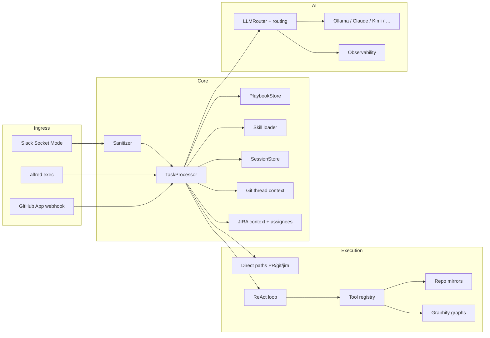

# Alfred

**Alfred** is a local-first AI assistant for small teams. Install it once, connect Slack and your AI provider, mirror your repos, and `@alfred` answers in thread — with per-conversation memory, channel history, **git investigation**, PR review, and company-specific **playbooks**.

Built for companies that want a distributable agent (not a SaaS): config + encrypted secrets in `.alfred/`, optional Ollama on your machine, and a web admin UI for setup and usage tracking.

> **Status:** Alpha — Slack ingress, session memory, git mirrors, read-only code investigation, PR review, **JIRA ticket tools**, **Slack↔JIRA↔GitHub identity mapping**, Graphify code graphs, ReAct agent loop, observability (tokens + estimated cost), and pluggable AI (including Kimi) are working. Write ops, AWS tools, and full skill matching are planned. See [implementation tracker](docs/build-reference/building_phase_v0.md).

**Requires Python 3.10+.** Local development targets **Python 3.13** (see `.python-version`). macOS system `python3` is often 3.9 and will not work.

---

## What Alfred does today

| Capability | Description |
|------------|-------------|
| **Slack `@alfred` mentions** | Socket Mode ingress — no public URL required. Replies stay in the thread. |
| **Thinking indicator** | Native Slack Assistant status when Agents & AI Apps is enabled. |
| **Per-thread memory** | SQLite session store — follow-ups in the same thread keep context (including active PR / last git action). |
| **Channel + thread history** | Fetches Slack messages (default **30-day** window) with reaction display names. |
| **Git investigation** | Mirror repos locally; `grep_repo`, `read_file`, `git_log`, `git_blame`, `git_show` via ReAct loop or direct routing. |
| **PR review** | Summarize and review PRs from URLs or thread context; deterministic overview + diff analysis. |
| **Open PRs / repo queries** | List PRs, get PR metadata — direct routing without full agent loop when intent is clear. |
| **GitHub PR comment bot** | Optional GitHub App webhook — `@alfred review` on PR comments (requires public URL / tunnel). |
| **JIRA tickets** | Search, get, update, comment, create, and link issues via `jira_management` / `jira_ticket` skills. |
| **Assignee resolution** | Slack `@mentions` → JIRA assignee emails via `assignee_map` + JIRA user search; avoids wrong `currentUser()` defaults. |
| **Workspace identity map** | Bulk map all Slack members to JIRA + GitHub; outputs `assignee_map` YAML for config. |
| **Graphify** | Optional knowledge graphs on repo sync — `query_graph` tool for semantic code search (when enabled). |
| **Domain playbooks** | `.alfred/playbooks/*.md` — YAML triggers + instructions for **your company's** formatting rules (local only). |
| **Shipped skills** | Generic `skills/*.md` in the repo — investigate, review PR, git status, JIRA, summarize bugs/alerts (committed with Alfred). |
| **Pluggable AI** | Ollama, OpenAI-compatible APIs, Anthropic, Gemini, **Kimi** — switch via config; route investigation to a capable model. |
| **Admin UI** | Chat, secrets, AI routing, repo mirrors, **Usage** dashboard (input/output tokens, est. cost, tools, users), health checks. |
| **CLI** | `alfred exec`, `alfred git sync`, `alfred up` / `alfred stop`. |

### Not built yet

- Git write operations (checkout, cherry-pick, open PR)
- AWS tools (CloudWatch, ECS, etc.)
- BM25 skill matcher and strict single-skill selection
- Thread relevancy ranking (beyond git session hints)
- Unified structured intent router (replacing per-domain direct routes)
- Durable task queue (Socket Mode handles Slack today; GitHub webhook is synchronous)

Details: [`docs/build-reference/building_phase_v0.md`](docs/build-reference/building_phase_v0.md)

---

## Skills vs playbooks (important)

| | **Skills** (`skills/`) | **Playbooks** (`.alfred/playbooks/`) |
|---|------------------------|--------------------------------------|
| **Purpose** | Generic agent behavior — investigate code, review PRs, list PRs | Company-specific rules — alert field names, table formats, bot quirks |
| **Shipped with Alfred** | Yes — in git | No — you create locally |
| **Commit to git?** | **Yes** | **No** — company-specific; `.alfred/` is gitignored |
| **Example** | `skills/investigate_bug.md` | Copy `docs/playbooks/example-slack-summaries.md` → `.alfred/playbooks/` and edit |

Never commit `.alfred/playbooks/` or other company context. The repo includes only generic examples under `docs/playbooks/`.

---

## Setup Alfred in your workspace

End-to-end checklist to run Alfred for your team. Pick **local**, **EC2**, or **ECS/Docker** for where Alfred runs — the configure steps are the same after install.

### Prerequisites

- Python **3.13** (local dev) or Docker (production)
- A Slack workspace where you can create an app
- At least one AI provider API key (Anthropic, Kimi/Moonshot, OpenAI, or local Ollama)
- GitHub or GitLab token with repo read access (for mirrors and PR tools)
- Disk space for repo mirrors under `.alfred/repos/` (depends on repo count/size)

### Step 1 — Get the code and install

**Local / EC2 (Python):**

```bash
git clone <your-fork-or-repo-url> alfred
cd alfred
chmod +x scripts/*.sh
./scripts/setup.sh
```

This creates `.venv`, installs `alfred-agent[ai,dev]`, runs `alfred init` in `./.alfred`, and seeds an example playbook.

**Docker / ECS:**

```bash
git clone <repo> alfred && cd alfred
docker compose up --build -d
```

First container start runs `alfred init` in the persistent volume. Admin token appears in logs:

```bash
docker compose logs alfred | grep -i token
# or locally:
alfred token
```

Save the admin token — you need it for the Admin UI.

### Step 2 — Open Admin UI

| Environment | Admin UI URL |
|-------------|--------------|
| Local dev (`./scripts/dev.sh` or `alfred up`) | http://127.0.0.1:5173 (Vite) or http://127.0.0.1:8080 (serve only) |
| Optional public dev host (Cloudflare Tunnel) | https://alfred.yourdomain.dev — see [Optional — Public URL](#optional--public-url-cloudflare-tunnel) |
| Docker / EC2 / ECS | http://\<host\>:8080 |

Authenticate with the admin token (`alfred token`).

### Step 3 — Secrets (Admin → Secrets)

Save encrypted secrets via the UI (preferred over plain env vars).

| Secret | Where to get it | Used for |
|--------|-----------------|----------|
| **Slack Bot Token** (`xoxb-…`) | Slack app → OAuth & Permissions → Install App | Posting replies, reading history |
| **Slack Signing Secret** | Slack app → Basic Information | Event verification |
| **Slack App-Level Token** (`xapp-…`) | Slack app → Socket Mode → App-Level Token with `connections:write` | Socket Mode (no public URL) |
| **AI API key** | Provider dashboard (Anthropic, OpenAI, Moonshot for Kimi, etc.) | LLM calls |
| **Git token** | GitHub PAT or GitLab token with `repo` read/write | PR API, repo mirrors, **GitHub PR comments + reactions** (via PAT user) |
| **JIRA API token** (optional) | Atlassian → Security → API tokens | JIRA search, get/update issues, assignee mapping |
| **GitHub webhook secret** (optional) | GitHub App → Webhook → Secret | Verify inbound PR comment webhooks |
| **AWS keys** (optional) | IAM user — not used by tools yet | Future Phase 7 |

Env var fallbacks: see [`.env.example`](.env.example) (`MOONSHOT_API_KEY` for Kimi, `GIT_TOKEN`, etc.).

### Step 4 — Slack app configuration

In [api.slack.com/apps](https://api.slack.com/apps):

1. Create app → enable **Socket Mode**
2. App-Level Token: `connections:write`
3. **OAuth & Permissions** → Bot Token Scopes:
   `app_mentions:read`, `channels:history`, `channels:read`, `chat:write`, `files:write`, `groups:history`, `groups:read`, `lists:read`, `users:read`, **`users:read.email`**, `assistant:write`
4. Enable **Agents & AI Apps** for native thinking status
5. **Event Subscriptions** → subscribe to `app_mention`
6. Install app to workspace
7. Paste all three Slack tokens in Admin → **Secrets** → enable Slack → save

Then in Slack: `/invite @Alfred` in a channel, `@alfred hello`.

Optional: Admin → **Integrations** → restrict `allowed_channels`.

`users:read` resolves Slack IDs to display names (Usage dashboard, identity map). **`users:read.email`** is required for Slack email addresses in workspace identity maps — without it, JIRA/GitHub matching falls back to names and handles only.

### Step 5 — AI provider (Admin → AI)

1. Enable your provider(s) and set API keys in Secrets if not already done
2. Set **Default provider** (e.g. `ollama` for local, `anthropic` or `kimi` for cloud)
3. Set **routing** in `config.yaml` or AI panel:
   - `ai.routing.investigation` → capable model for PR review and code search (e.g. `kimi`, `anthropic`)
   - `ai.routing.skill_matching` → can stay on `ollama` for cheap tasks

**Kimi:** provider key `kimi`, base URL `https://api.moonshot.ai/v1`, model `kimi-k2.6`, secret `MOONSHOT_API_KEY`.

Local Ollama small models (e.g. 3B) are unreliable for tool-calling — use Kimi/Claude for investigation.

### Step 6 — Git integration (Admin → Integrations + Secrets)

1. Enable Git in Integrations
2. Set provider (`github` or `gitlab`) and paste token in Secrets
3. In `config.yaml` (or via config API):

```yaml
git:
  enabled: true
  provider: github
  default_org: YourOrg        # short repo names like "backend" → YourOrg/backend
  repos:                      # optional allowlist; empty = discover via API
    - YourOrg/service-a
    - YourOrg/service-b
  mirror_ttl_hours: 24
  mirror_refresh_minutes: 30
```

4. Sync mirrors:

```bash
alfred git sync
```

5. Admin → **Repo mirrors** — verify shared cache, trigger sync, inspect workspaces

Mirrors live under `.alfred/repos/shared/` (cache) and `.alfred/repos/workspaces/{session}/` (per-conversation).

**Optional — Graphify** (semantic code graphs on sync):

```yaml
git:
  graphify_enabled: true
  graphify_extract_timeout_minutes: 120
```

Requires the `graphify` CLI on the host and a capable LLM for extraction (uses investigation routing). Enables the `query_graph` tool during investigation.

### Step 6b — GitHub App (PR comment bot) — optional

Use this when you want **`@your-app-slug review`** on **GitHub pull request comments** (not just Slack). Requires a **public HTTPS URL** — see [Optional — Public URL](#optional--public-url-cloudflare-tunnel).

1. Create a [GitHub App](https://github.com/settings/apps/new) named **`alfred`** (org or user). Users mention **`@alfred`** on PRs. The app slug is fixed at creation — if you already have `alfred-flx`, create a new app named `alfred` (or rename only if GitHub still allows changing the slug) and uninstall the old one.
2. Set URLs (replace host with yours, e.g. `alfred.flexype.dev`):

| Field | URL |
|-------|-----|
| **Callback URL** | `https://alfred.yourdomain.dev/api/v1/github/callback` |
| **Webhook URL** | `https://alfred.yourdomain.dev/api/v1/github/webhook` |

3. **Webhook secret** — generate on GitHub and paste the same value in Admin → **Secrets** → **GitHub App** → `github_webhook_secret`
4. **Permissions** — Repository: **Contents** (read), **Issues** (read & write), **Pull requests** (read)
5. **Subscribe to events** — `Issue comment`
6. **Install the app** on your org — grant access to **All repositories** or select repos ( **No repositories** = no webhooks ). Accept updated permissions after changing app settings.
7. Admin → **Integrations** → **GitHub App**:
   - Enable toggle
   - **Client ID** / **App ID** from GitHub App settings
   - **Bot login** = `alfred` — must match the GitHub App slug / `@mention` exactly
   - **Public base URL** = `https://alfred.yourdomain.dev` (shows copyable webhook/callback URLs)
   - Save changes

Or in `config.yaml`:

```yaml
github:
  enabled: true
  client_id: Iv1.xxxxx
  app_id: "123456"
  bot_login: alfred
  callback_base_url: https://alfred.yourdomain.dev
  allowed_repos: []                  # optional; empty uses git.repos allowlist
```

8. Admin → **Secrets** — also ensure:
   - `git_token` — PAT with `repo` scope (Alfred posts PR review replies and 👀/👍 reactions **as the PAT user** today)
   - `github_client_secret` (optional, for OAuth callback only)

9. Run Alfred + tunnel, then verify:

```bash
./scripts/up.sh          # terminal 1
./scripts/tunnel.sh      # terminal 2
curl -s https://alfred.yourdomain.dev/api/health
```

GitHub App → Webhook → **Recent deliveries**: `ping` and `issue_comment` should return **200**. In `.alfred/alfred.log` look for `status=queued` (not `ignored issue_comment`).

Comment on a PR: `@alfred can you review this PR?` — Alfred reacts with 👀 immediately, posts the review when done, then 👍. Same `review_pr` skill as Slack.

**Troubleshooting**

| Symptom | Fix |
|---------|-----|
| Log: `ignored issue_comment` | **Bot login** mismatch — set `alfred` to match your GitHub App slug |
| No webhook in log | App installed with **No repositories**, tunnel down, or `Issue comment` event not subscribed |
| Log: `signature verification failed` | Re-paste webhook secret on GitHub and in Alfred Secrets |
| Reactions show as your user | Expected with PAT — webhook is the app; API calls use `git_token` |

### Step 6c — JIRA (optional)

Use when the team tracks work in JIRA Cloud and wants `@alfred` to search tickets, resolve assignees from Slack `@mentions`, or build a workspace identity map.

1. Admin → **Secrets** — add **JIRA API token** (Atlassian account → Security → API tokens)
2. Admin → **Integrations** → enable **JIRA**:
   - **Site URL** — e.g. `https://yourorg.atlassian.net`
   - **Email** — Atlassian account email for API auth
   - **Default project** — e.g. `ENG` or `TECH`
3. Or in `config.yaml`:

```yaml
jira:
  enabled: true
  base_url: https://yourorg.atlassian.net
  email: dev@yourorg.io
  default_project: TECH
  allowed_projects: []          # empty = no restriction; or list keys
  assignee_map:                 # optional — improves @mention → JIRA assignee
    "Jane Doe": jane@yourorg.io
    U01234567: jane@yourorg.io
```

4. Admin → **Health** — JIRA row should show connected site + user
5. In Slack:
   - `@alfred list open tickets assigned to @Jane` — uses resolved assignee, not `currentUser()`
   - `@alfred map all slack users to jira and github` — bulk workspace identity map + suggested `assignee_map` YAML

**Skills:** `skills/jira_management.md` (search, update, comment, create, identity map), `skills/jira_ticket.md` (link PRs to tickets).

### Step 7 — Company playbooks (local only)

```bash
mkdir -p .alfred/playbooks
cp docs/playbooks/example-slack-summaries.md .alfred/playbooks/my-alerts.md
# edit triggers and formatting rules for your bots/fields
```

Playbooks are loaded on each request when trigger keywords match. **Do not commit** `.alfred/` — it contains secrets, DB, mirrors, and company playbooks.

See [`docs/playbooks/README.md`](docs/playbooks/README.md).

### Step 8 — Run Alfred

**Local development:**

```bash
./scripts/up.sh          # background: API + Slack + Vite UI (+ Ollama if default)
# or foreground:
./scripts/dev.sh
```

Stop: `alfred stop`

**Production (serve only, no Vite):**

```bash
source .venv/bin/activate
alfred serve --host 0.0.0.0 --port 8080
```

**Docker:**

```bash
docker compose up -d
docker compose logs -f alfred
```

Logs: `.alfred/alfred.log` (or `docker compose logs`).

**No tunnel required.** `./scripts/up.sh` alone is enough for local dev: Admin UI on `http://127.0.0.1:8080`, Slack via Socket Mode, PR review in Slack threads, git mirrors, and CLI. You do **not** need `cloudflared`, a public hostname, or `~/.cloudflared/config.yml` unless you want inbound webhooks (see optional step below).

### Optional — Public URL (Cloudflare Tunnel)

Use this **only** when you need Alfred reachable from the internet — for example a **GitHub App webhook** (`@alfred` on PR comments), sharing Admin UI outside your laptop, or testing HTTPS callbacks. It does **not** affect Slack (Socket Mode is outbound-only) and does **not** change how `./scripts/up.sh` works locally.

| Scenario | Tunnel needed? |
|----------|----------------|
| Slack `@alfred`, local Admin UI, PR review in Slack | **No** |
| GitHub PR comment bot (`@alfred review`) | **Yes** |
| Remote Admin UI without VPN | **Yes** (or EC2/nginx instead) |

Each public hostname (e.g. `alfred.yourdomain.dev`) is a **separate DNS record** — adding Alfred’s subdomain does not change other dev hosts on the same domain.

**One-time setup** (requires [Cloudflare](https://dash.cloudflare.com) and `brew install cloudflared`):

```bash
cloudflared tunnel login
cloudflared tunnel create alfred-dev
cloudflared tunnel route dns alfred-dev alfred.yourdomain.dev
```

Create `~/.cloudflared/config.yml` (use your tunnel UUID from `cloudflared tunnel list`):

```yaml
tunnel: alfred-dev
credentials-file: /Users/you/.cloudflared/<TUNNEL-UUID>.json

ingress:
  - hostname: alfred.yourdomain.dev
    service: http://127.0.0.1:8080
  - service: http_status:404
```

**When you need the public URL**, run Alfred and the tunnel in two terminals:

```bash
./scripts/up.sh          # terminal 1 — same as always
./scripts/tunnel.sh      # terminal 2 — optional; skips if config missing
```

Verify: `curl -s https://alfred.yourdomain.dev/api/health`

Environment overrides for `scripts/tunnel.sh`: `ALFRED_TUNNEL_NAME`, `CLOUDFLARED_CONFIG`.

If you skip tunnel setup, Alfred behaves exactly as before — only `./scripts/up.sh` (or `./scripts/dev.sh`).

### Step 9 — Verify

| Check | How |
|-------|-----|
| Health | Admin → Health — Slack, AI, Git mirrors, **JIRA** |
| Chat | Admin → Chat — ask a question without Slack |
| Slack | `@alfred what are my open PRs?` |
| Investigate | `@alfred where is X handled in org/repo?` (after `alfred git sync`) |
| PR review (Slack) | Paste a PR URL in thread, `@alfred review this PR` |
| PR review (GitHub) | Comment `@your-app-slug review` on a PR (requires GitHub App + tunnel) |
| JIRA | `@alfred list my open TECH tickets` or `@alfred status of ENG-123` |
| Identity map | `@alfred map all slack users to jira and github` (needs `users:read.email`) |
| Usage | Admin → Usage — input/output tokens, est. cost, tools, users over time |

---

## Deploy on AWS

Alfred uses **Slack Socket Mode** — outbound WebSocket to Slack. You do **not** need a public HTTPS endpoint for Slack events. You **do** need outbound internet (Slack, AI APIs, Git).

### EC2 (single instance)

Good for a small team; simplest production path.

1. **Instance** — e.g. `t3.medium` or larger; **30+ GB** EBS if mirroring many repos
2. **Security group** — inbound **8080** (or 443 via reverse proxy) restricted to your office/VPN IP for Admin UI; outbound HTTPS allowed
3. **Install** — Docker (recommended) or Python 3.13 + `./scripts/setup.sh`
4. **Persistent data** — mount EBS at `/data` and set `ALFRED_DATA_DIR=/data/.alfred`, or use Docker volume:

```bash
export ALFRED_DATA_DIR=/data/.alfred
docker compose up -d
```

5. **Process manager** — `restart: unless-stopped` in compose, or systemd unit calling `alfred serve`
6. **Configure** — follow Steps 2–9 above via browser to `http://<ec2-ip>:8080`
7. **Ollama on EC2** (optional) — only if using local models; otherwise use cloud AI keys only

No Application Load Balancer required for Slack. Add nginx + TLS in front of `:8080` if exposing Admin UI on the public internet.

### ECS (Fargate)

Good when you already run containers on AWS.

1. **Build & push** image from this repo's `Dockerfile` to ECR
2. **Task definition** — port 8080, env `ALFRED_DATA_DIR=/data/.alfred`
3. **Persistent volume** — mount **EFS** at `/data/.alfred` so secrets, DB, mirrors, and playbooks survive redeploys
4. **Networking** — task in private subnet with NAT gateway (outbound to Slack, AI, GitHub)
5. **Load balancer** (optional) — ALB → 8080 for Admin UI; not required for Slack Socket Mode
6. **Secrets** — prefer mounting playbooks on EFS or baking none; enter API/Slack keys via Admin UI on first boot (admin token from logs)
7. **Health check** — `GET /api/health` (configured in Dockerfile)

Playbooks on ECS: edit files on the EFS mount (e.g. `playbooks/my-alerts.md`) or sync from an internal bucket at startup — keep them **out of git**.

### Docker Compose (any host)

```bash
docker compose up --build -d
```

- Port: `8080`
- Volume: `alfred_data` → `/data/.alfred`
- Skills mounted read-only from `./skills` (override in compose if needed)

---

## Architecture (high level)



**Design principles** ([`docs/build-reference/v0.md`](docs/build-reference/v0.md)):

- **Local-first** — data in `.alfred/`
- **Generic core** — company rules in local playbooks, not Python
- **Pluggable AI** — config-driven providers and per-task routing
- **Governed execution** (partial) — skills define allowed tools; observability tracks usage

---

## Quick start (local only)

```bash
chmod +x scripts/*.sh
./scripts/setup.sh
./scripts/up.sh
```

| Service | URL |
|---------|-----|
| Admin UI (dev) | http://127.0.0.1:5173 |
| API + bundled UI (`serve`) | http://127.0.0.1:8080 |
| Health | http://127.0.0.1:8080/api/health |

```bash
alfred token    # admin token for UI
alfred status   # init state, Slack readiness
```

Then complete [Setup steps 3–9](#step-3--secrets-admin--secrets) for Slack, AI, and Git.

---

## CLI reference

| Command | Description |
|---------|-------------|
| `alfred init` | Create `.alfred/`, config, encrypted secrets, example playbook |
| `alfred init --force` | Re-initialize (new admin token) |
| `alfred serve` | Start API, admin UI, Slack Socket Mode listener |
| `alfred serve --reload` | Dev auto-reload |
| `alfred up` | Start API + Slack in background; optional Vite UI and Ollama |
| `alfred stop` | Stop background Alfred (and optional Ollama) |
| `alfred status` | Data dir, init state, default AI provider, Slack readiness |
| `alfred token` | Print admin token for the UI |
| `alfred exec "…"` | Run a message through Alfred locally (no Slack post) |
| `alfred git sync` | Clone/update shared repo mirrors |
| `alfred git workspaces` | List per-session mirror workspaces |
| `alfred git cleanup` | Remove expired mirror workspaces |
| `alfred ollama setup` | Install, start, pull default Ollama model |

Global option: `--data-dir PATH` (default: `ALFRED_DATA_DIR` env, else `./.alfred`)

---

## Configuration

### Data directory (`.alfred/`)

| File / path | Purpose |
|-------------|---------|
| `config.yaml` | Non-secret settings (AI, Slack, git, routing, observability aliases) |
| `secrets.enc` | Encrypted tokens and API keys |
| `.key` | Local encryption key (mode 600) |
| `alfred.db` | Sessions + observability events (SQLite) |
| `alfred.log` | Runtime logs |
| `playbooks/` | **Your** domain Markdown playbooks (not in git) |
| `repos/` | Git mirror cache and session workspaces |

**Local dev:** `./.alfred` in the repo (`scripts/env.sh` sets `ALFRED_DATA_DIR`).

Clean duplicate state: `./scripts/clean-local.sh`

### Example routing + git snippet

```yaml
ai:
  default_provider: ollama
  routing:
    skill_matching: ollama
    investigation: kimi
git:
  enabled: true
  default_org: YourOrg
  graphify_enabled: false
jira:
  enabled: true
  base_url: https://yourorg.atlassian.net
  email: dev@yourorg.io
  default_project: ENG
observability:
  user_labels:
    U0522NX5GG0: "Amit"   # optional fallback if Slack users:read unavailable
  model_pricing:           # optional — override est. cost per model in Usage UI
    kimi-k2.6:
      input_per_million: 0.60
      output_per_million: 2.40
```

### Environment variables

See [`.env.example`](.env.example): `ALFRED_DATA_DIR`, `ALFRED_HOST`, `ALFRED_PORT`, optional `ALFRED_ADMIN_TOKEN`.

Secrets are preferred via Admin UI → encrypted storage.

---

## AI providers

| Provider | Config key | Notes |
|----------|------------|-------|
| **Ollama** (local) | `ollama` | Default; `pip install alfred-agent[ai-openai]` |
| OpenAI / Groq / Together | `openai` | OpenAI-compatible API |
| Anthropic Claude | `anthropic` | `pip install alfred-agent[ai-anthropic]` |
| Google Gemini | `gemini` | `pip install alfred-agent[ai-gemini]` |
| **Kimi** (Moonshot) | `kimi` | `https://api.moonshot.ai/v1`, model `kimi-k2.6` |

Install all: `pip install alfred-agent[ai]`

---

## Admin UI

| Section | Purpose |
|---------|---------|
| **Home** | Overview, Ollama get-started |
| **Chat** | Test Alfred without Slack |
| **AI** | Providers, models, default + routing |
| **Secrets** | Slack, Git, **JIRA**, AWS, API keys (encrypted) |
| **Integrations** | Toggle services, channel allowlists, **JIRA site/project** |
| **Repo mirrors** | Sync status, shared cache, workspaces |
| **Usage** | AI tokens (input/output split), **est. cost**, tool calls, users — filters and charts |
| **Health** | Slack, AI, Git connectivity |

Dev: `cd frontend && npm run dev`. Production: static bundle served by FastAPI on `:8080`.

---

## Project layout

```
alfred/
├── backend/
│   ├── agent/              # ReAct loop
│   ├── ai/                 # LLM adapters + instrumentation
│   ├── api/                # FastAPI routes
│   ├── context/            # Graphify graph build + query
│   ├── git/                # Mirrors, sandbox, API client
│   ├── ingress/            # Processor, playbooks, PR analysis, git/jira context, identity map
│   ├── jira/               # JIRA Cloud REST client
│   ├── observability/      # Usage tracking, pricing, Slack user labels
│   ├── slack/              # Socket Mode listener
│   ├── storage/            # SQLite sessions + slack user cache
│   ├── tools/              # Tool registry, git_local, git_api, jira_tool, graphify
│   └── cli.py
├── frontend/               # React admin UI
├── skills/                 # Generic skills (committed) — git, JIRA, investigate, …
├── docs/
│   ├── playbooks/          # Example playbooks (copy to .alfred/playbooks/)
│   └── build-reference/    # Architecture + building_phase_v0.md
├── tests/
├── scripts/                # setup.sh, up.sh, dev.sh, tunnel.sh (optional)
├── Dockerfile
└── docker-compose.yml
```

---

## Development

```bash
source .venv/bin/activate
uv run pytest tests/ -q
ruff check backend tests
```

Production wheel: `./scripts/build-release.sh`

---

## Documentation

| Document | Description |
|----------|-------------|
| [`docs/build-reference/v0.md`](docs/build-reference/v0.md) | Full layer architecture |
| [`docs/build-reference/building_phase_v0.md`](docs/build-reference/building_phase_v0.md) | **Implementation status & gaps** |
| [`docs/playbooks/README.md`](docs/playbooks/README.md) | Playbook format (local `.alfred/playbooks/`) |
| [`docs/README.md`](docs/README.md) | Docs index |

---

## Example interactions

**Slack:**

```
@alfred what are my open PRs?
@alfred review https://github.com/YourOrg/backend/pull/42
@alfred where is duplicate order handled in backend?
@alfred list open TECH tickets assigned to @Jane
@alfred map all slack users to jira and github
@alfred summarize what happened in this channel last week
```

**CLI:**

```bash
alfred exec "list open PRs on YourOrg/backend"
alfred git sync && alfred exec "grep for OrderValidator in backend"
```

---

## Roadmap (summary)

| Phase | Goal | Status |
|-------|------|--------|
| ✅ 0–1 | Foundation, config, pluggable AI | Done |
| ✅ 3 | Slack ingress + thread replies | Done |
| 🟡 2–4 | Skills (partial), context (partial), git/JIRA hints | In progress |
| 🟡 5 | ReAct loop + read-only git + **JIRA read/write tools** | In progress |
| 🟡 7–8 | Admin UI + Usage (incl. cost); Docker/docs; **JIRA + Graphify** | In progress |
| ❌ 6 | Write git, governance, confirmation | Not started |
| ❌ 7 | AWS tools | Not started |

Full gap list and layer-by-layer status: [`building_phase_v0.md`](docs/build-reference/building_phase_v0.md)

---

## License

MIT — see [LICENSE](LICENSE).
