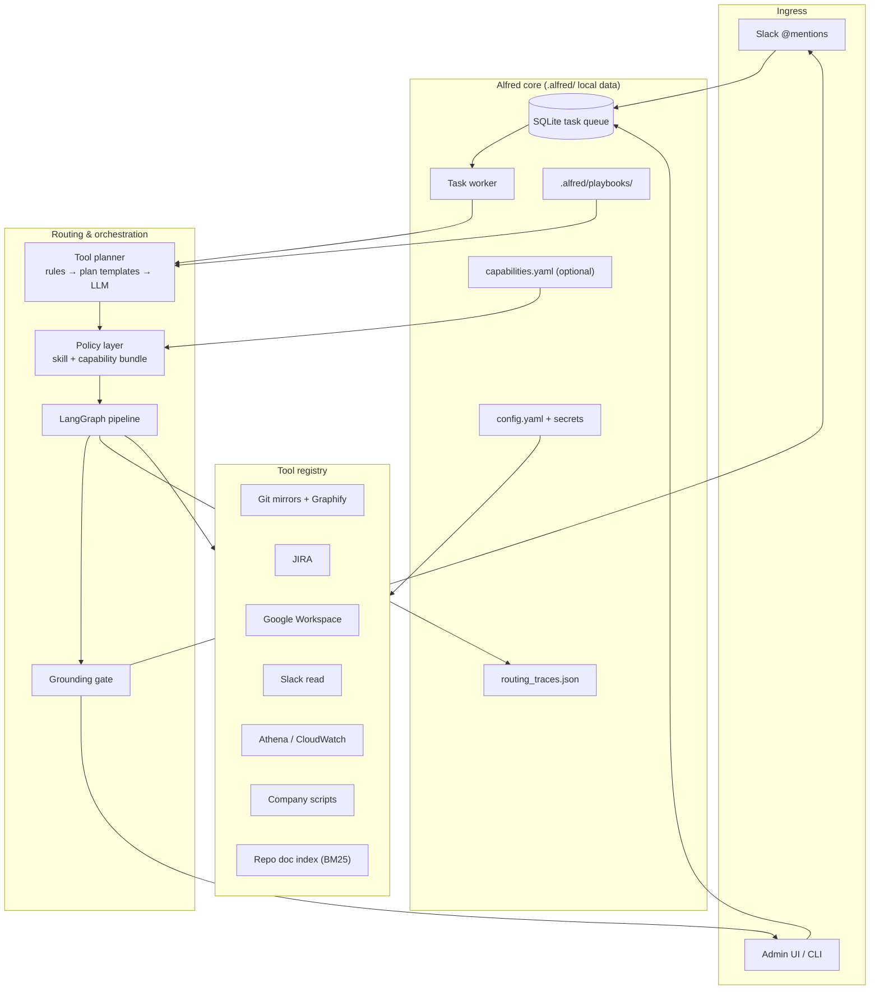
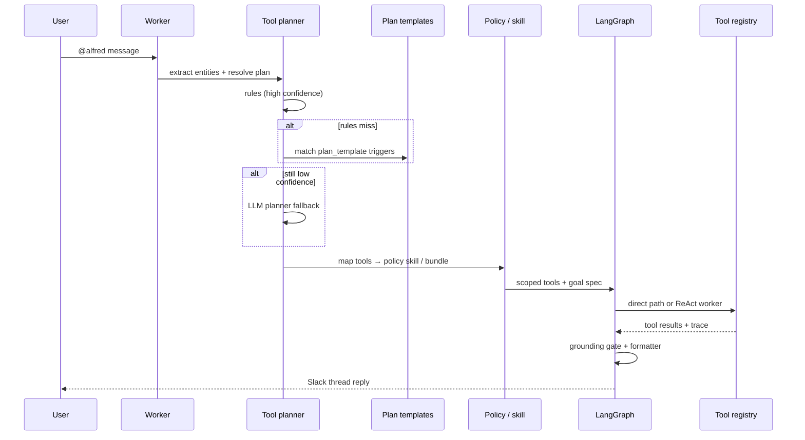

# Alfred Architecture Overview

> **Living diagram** for the routing revamp (Phases 0–4).  
> Detailed plan: [`routing-and-tools-plan.md`](routing-and-tools-plan.md) · Progress: [`implementation-status.md`](implementation-status.md)  
> Request entities + flow: [`request-processing.md`](request-processing.md)

**Last updated:** 2026-08-05

---

## System context



---

## Investigation request flow (Phase 4)



LangGraph nodes:

```
extract_entities → plan_tools → validate_plan
  → try_direct | run_worker → validate_goal → format_reply
```

State persists to `.alfred/langgraph_checkpoints.db` when `routing.langgraph_checkpoint: true`.

---

## Routing tiers (investigation)

| Tier | Default | Role |
|------|---------|------|
| **Plan-first** | On | Rules + plan templates → policy skill |
| **Phrase routing** | **Off** | Keyword / heuristic / BM25 skill router (legacy) |
| **Skill router LLM** | Fallback | When plan-first misses and `skill_router_fallback: true` |
| **Conversational playbooks** | On | Keyword triggers still apply for `mode: conversational` |

Set `routing.phrase_routing_enabled: true` to restore investigation keyword routing.

---

## Capability bundles

Domain tool groups live in code (`backend/routing/capabilities.py`) with optional overrides in `.alfred/capabilities.yaml`.

| Bundle | Policy skill | Example tools |
|--------|--------------|---------------|
| `jira` | `jira_management` | `jira_search`, `get_jira_issue`, … |
| `google` | `google_workspace` | Sheets + Docs |
| `slack_read` | `summarize_bugs` | `slack_fetch_thread`, … |
| `repo` | `investigate_bug` | `grep_repo`, `query_graph`, … |
| `repo_docs` | `repo_knowledge` | `search_repo_docs`, … |
| `script` | `investigate_bug` | `run_company_script` |
| `aws` | `aws_query` | `athena_query`, … |

Policies (`type: policy` in playbooks) reference a bundle instead of duplicating long `allowed_tools` lists.

---

## Repo knowledge (multi-repo)

On `alfred git sync`:

- **All successfully synced repos** → doc BM25 index rebuild (`repo_knowledge.index_on_sync`)
- **Main repo only** → overview manifest + Graphify extraction (when enabled)

Tools: `search_repo_docs`, `read_repo_doc`, `list_repo_docs`, `query_graph`.

---

## Admin surfaces

| Panel | Path | Purpose |
|-------|------|---------|
| Tools | Configure → Tools | Full tool catalog + governance |
| Routing | Configure → Routing | Recent intent → plan → graph traces |
| Usage | Configure → Usage | Token usage + task checkpoints |

API: `GET /api/routing/traces`, `GET /api/routing/capabilities`, `GET /api/tools/catalog`.

---

## Key modules

| Module | Role |
|--------|------|
| `backend/routing/tool_planner.py` | Rules + templates + LLM planning |
| `backend/routing/plan_templates.py` | Trigger → structured `ToolPlan` |
| `backend/routing/capabilities.py` | Bundle definitions |
| `backend/routing/policies.py` | Resolve tools from bundle |
| `backend/routing/trace_store.py` | Routing debugger persistence |
| `backend/orchestrator/graph/` | LangGraph orchestration |
| `backend/context/doc_index.py` | Repo documentation BM25 index |

---

*Update alongside [`implementation-status.md`](implementation-status.md) when architecture changes.*
