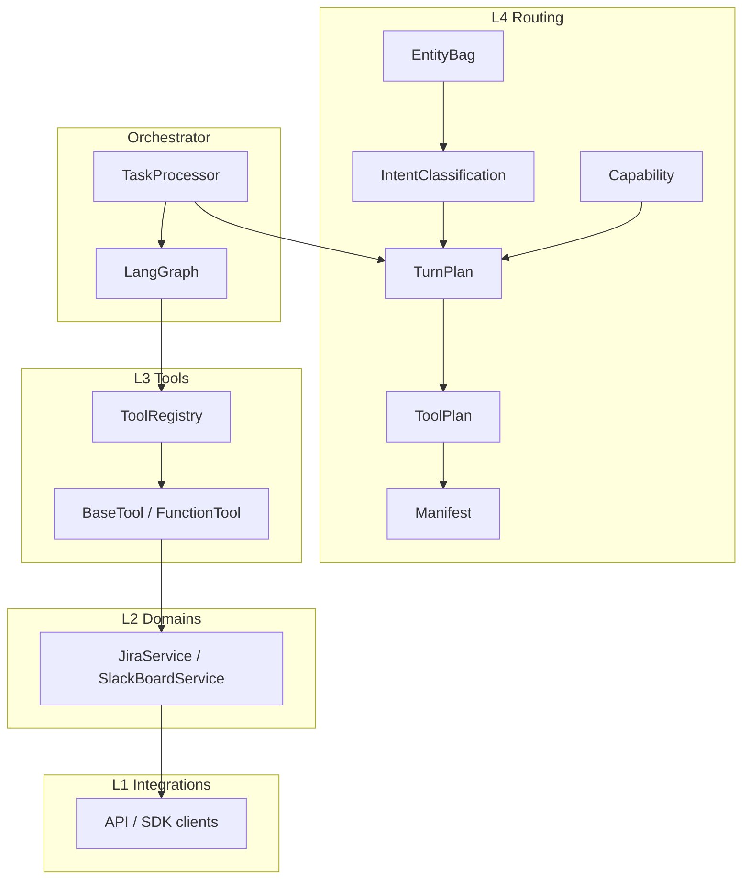
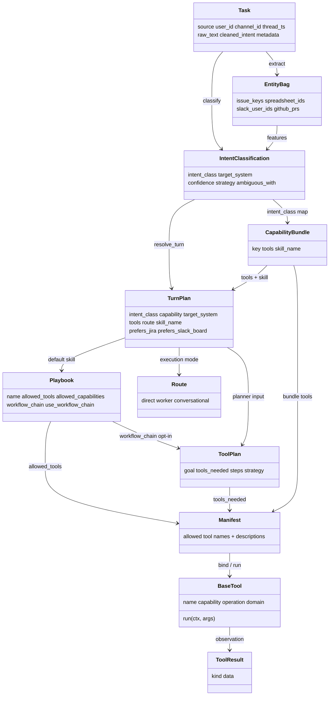
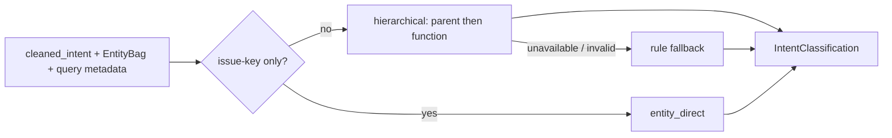
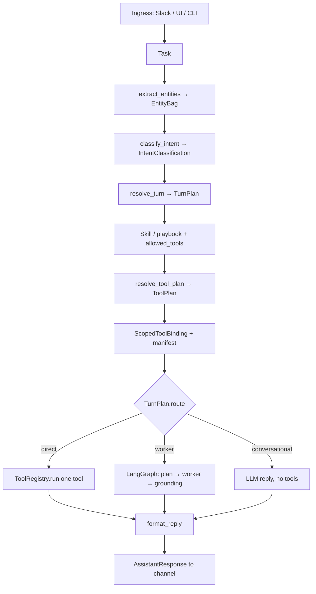
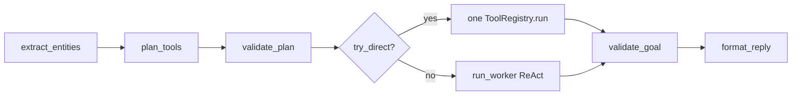
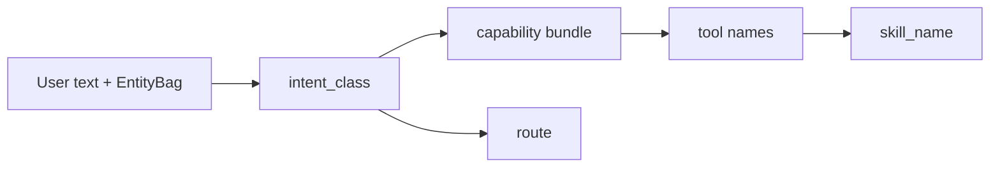
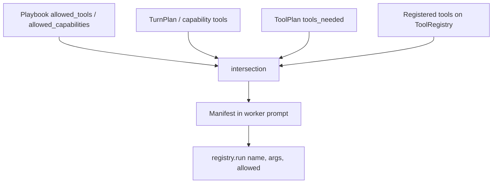
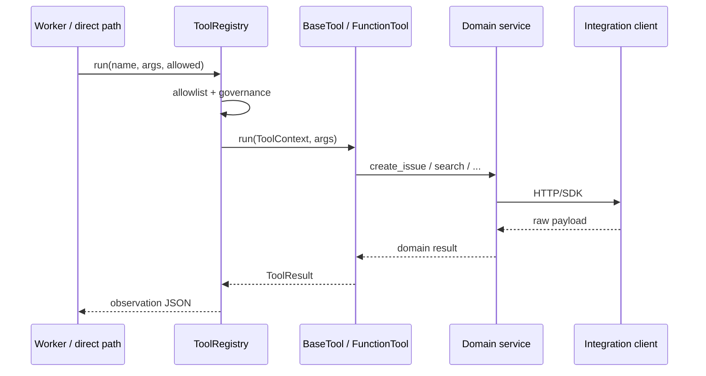

# Request processing — entities and flow

> How a user message becomes a routed, planned, tool-scoped reply.  
> Related: [`tools-routing-v2-plan.md`](tools-routing-v2-plan.md) · [`implementation-status.md`](implementation-status.md) · [`overview.md`](overview.md)

**Last updated:** 2026-08-17

---

## 1. Layers (who owns what)

```
tools → domains → integrations     (never the reverse)
routing + orchestrator call tools/domains
```

| Layer | Path | Role |
|-------|------|------|
| Ingress | Slack / UI / CLI / scheduler | Build a `Task` |
| L4 Routing | `backend/routing/` | Entities, classification, capability, plan, manifest |
| Orchestrator | `backend/orchestrator/` | Turn lifecycle, LangGraph or direct tool run |
| L3 Tools | `backend/tools/` | `BaseTool` / `FunctionTool` — LLM-callable operations |
| L2 Domains | `backend/domains/` | Product verbs (create issue, create board task) |
| L1 Integrations | `backend/integrations/` | HTTP/SDK clients |



---

## 2. Entity relationship

These objects are produced **in order** for each turn. None of them is a tool.



| Entity | Question it answers | Not |
|--------|---------------------|-----|
| **EntityBag** | Which IDs/URLs are in the text? | Which system to write to |
| **IntentClassification** | What kind of turn is this? | Which tools, in what order |
| **Capability** | Which tools are *allowed* for that kind? | Execution path |
| **TurnPlan** | Capability + tools + **route** + skill for this turn | Ordered steps |
| **ToolPlan** | Which tools, in what order? | Route (`direct` vs `worker`) |
| **Route** | How does the orchestrator execute? | Which tools exist |
| **Manifest** | What may the model call this turn? | Domain HTTP details |
| **Playbook / Skill** | Policy, prompts, optional chain | Runtime registry |
| **BaseTool** | One LLM-callable operation | Classification |

---

## 3. Entity glossary

### Task
Ingress unit. Fields: `source`, `user_id`, `channel_id`, `thread_ts`, `raw_text`, `cleaned_intent`, `metadata`.

Stored on the task: `metadata["turn_plan"]` after `resolve_turn()`.

### EntityBag
Deterministic extract from text (`entity_extractor.py`). Not intent.

| Field | Example |
|-------|---------|
| `issue_keys` | `TECH-12` |
| `spreadsheet_ids` / `document_ids` | Google IDs from URLs |
| `slack_user_ids` | `<@U123>` |
| `github_prs` | `(owner/repo, 42)` |

Regex extracts **entities only**. “Is this JIRA or Slack?” is classification, not extraction.

### IntentClassification
Closed label for this turn (`classifier/classify.py`).

| Field | Meaning |
|-------|---------|
| `intent_class` | Closed enum, e.g. `jira.write.create` |
| `target_system` | `jira` / `slack_board` / `git` / … |
| `confidence` | 0–1 |
| `entities` | Dict snapshot of the bag |
| `ambiguous_with` | Other plausible classes |
| `strategy` | `rules`, `llm_hierarchical`, or `entity_direct` |

Canonical names live in `intent_classes.py` (aliases: `html_slides` → `artifact.write.deck`).



Prompt routing is the primary classifier (`routing.classifier_enabled`, default **true**). Rules run only when the model cannot decide. Do **not** force a TurnPlan skill when `intent_class` is `unknown`.

### Capability / CapabilityBundle
Named allowlist of tools plus skill/policy (`capabilities.py`).

Example: `jira.write.create` → tools `{jira_create_issue}`, policy `jira_management`.

Skills may declare `allowed_capabilities`. Explicit `allowed_tools` still wins.

Fine-grained keys: `jira.write.create`, `slack.board.write.create`, `git.pr.read`, `aws.read.query`, …

### TurnPlan
**One resolver output per turn** (`resolver.resolve_turn()`).

| Field | Meaning |
|-------|---------|
| `intent_class` | Canonical class |
| `capability` | Bundle key |
| `target_system` | Where the write/read goes |
| `tools` | Names the registry may bind |
| `route` | `direct` / `worker` / `conversational` |
| `skill_name` | Default playbook |
| `confidence` | From classification |

`prefers_jira` / `prefers_slack_board` stop Slack List handlers from stealing JIRA creates.

### ToolPlan
Ordered steps for the agent (`tool_plan_types.py`). Strategies: `rules`, `llm`, `workflow_chain`, HTML-slides deterministic.

| Field | Meaning |
|-------|---------|
| `goal` | Short description |
| `tools_needed` | Ordered tool names |
| `steps` | `ToolPlanStep(tool, purpose, args_hint)` |
| `intent_class` | Optional echo of classification |

Skill frontmatter `workflow_chain` becomes a `ToolPlan` only when `use_workflow_chain: true`.

### Route
How this turn **executes**:

| Value | When | What runs |
|-------|------|-----------|
| `direct` | High confidence, usually one tool | Registry `run()` without ReAct |
| `worker` | Multi-tool or generation (create, slides, docs) | LangGraph / agent loop |
| `conversational` | `unknown` / chat | No tools (or skill chat) |

### Manifest
Prompt block listing **exactly** the tools for this turn (`format_tool_manifest`). Stops the model inventing `jira_create_ticket`. Built from `allowed_tools` after skill + plan + capability intersection.

### Playbook / Skill
Markdown + YAML frontmatter: `allowed_tools`, `allowed_capabilities`, `workflow_chain`, `use_workflow_chain`. Bundled under `skills/`.

Set `use_workflow_chain: true` only when that chain **is** the default plan (`html_slides`, `create_pr`, `repo_knowledge`). Mixed skills (JIRA, Slack board, schedule) keep the chain as a hint.

### BaseTool / FunctionTool
L3 contract: `name`, `capability`, `operation`, `domain`, `run(ctx, args)`, `produces` / `consumes` / `next_tools`. Closures wrap as `FunctionTool`. Domain folders register via `ToolBundle` (`iter_tool_bundles()`).

### ToolResult
Structured observation: `kind` + `data` (e.g. `jira_action`, `pr_list`, `error`).

---

## 4. How a request is processed



### Step by step

1. **Ingress** builds `Task` (cleaned text, channel, thread).
2. **Entities** — IDs and URLs only.
3. **Classify** — hierarchical prompt router (parent → function → capability); rules only if the model fails. Issue-key-only messages skip the LLM.
4. **TurnPlan** — capability → tools → route → default skill. Stored on `task.metadata["turn_plan"]`.
5. **Processor guards** — if `prefers_jira`, skip Slack List create/update. Admin Slack List commands still short-circuit first.
6. **Skill** — investigation playbook; TurnPlan may force JIRA / HTML slides skill on collision.
7. **ToolPlan** — HTML slides rules, then optional `workflow_chain`, then phrase rules / LLM planner.
8. **Bind** — intersect skill tools ∩ plan tools ∩ registered tools; render **manifest**.
9. **Execute** — `direct` one shot, or **worker** (LangGraph default), or chat.
10. **Ground + format** — grounding gate for investigation; formatter by `intent_class`; render for Slack vs UI.

LangGraph investigation subgraph (when route is `worker`):



---

## 5. Classification → capability → tools → route



| intent_class | capability | Primary tools | Default skill | Typical route |
|--------------|------------|---------------|---------------|---------------|
| `jira.write.create` | `jira.write.create` | `jira_create_issue` | `jira_management` | `worker` |
| `slack.board.write.create` | `slack.board.write.create` | `slack_board_create_task` | `slack_board_management` | `direct` or `worker` |
| `artifact.write.deck` | `artifact.write.deck` | `save_html_deck`, `publish_html_artifact` | `html_slides` | `worker` |
| `repo.docs.qa` | `repo.docs.qa` | `search_repo_docs`, `read_repo_doc` | `repo_knowledge` | `worker` |
| `git.pr.review` | `git.pr.review` | git read/write set | `review_pr` / `create_pr` | `worker` |
| `unknown` | — | none | conversational | `conversational` |

Maps: `INTENT_TO_CAPABILITY`, `INTENT_TO_SKILL`, `INTENT_TO_TOOLS` in `intent_classes.py`.

---

## 6. Binding: skill ∩ plan ∩ capability ∩ registry

The model never sees the full catalog. Binding produces the **manifest**.



Priority: explicit `allowed_tools` on the skill wins over `allowed_capabilities`. Plan tools further narrow. Unregistered names are dropped.

---

## 7. ToolPlan vs TurnPlan

| | TurnPlan | ToolPlan |
|--|----------|----------|
| Question | *What kind of turn is this?* | *Which tools, in what order?* |
| Owner | `resolve_turn()` | `resolve_tool_plan()` |
| Always | Yes, every investigation/UI turn | When planner enabled and skill has tools |
| Example | `jira.write.create`, route `worker` | `jira_create_issue` → `jira_assign_issue` |

Workflow chain (opt-in):

```yaml
# skills/html_slides.md
workflow_chain:
  - save_html_deck
  - publish_html_artifact
use_workflow_chain: true
```

Mixed skills (JIRA, schedule) may list a chain as a **hint** without `use_workflow_chain`, so “list tickets” is not forced through create.

---

## 8. Manifest (prompt contract)

After binding, the worker prompt includes:

```
## Tool manifest (this turn)
You have EXACTLY these tools:
- `jira_create_issue` — Create a new JIRA issue
```

Descriptions come from `BaseTool.description()` via `iter_tool_bundles()`, then catalog fallbacks.

---

## 9. Tools: contract and folders

Every LLM-callable operation is a `BaseTool`. Remaining register-style handlers wrap as `FunctionTool`. Bundles register onto `ToolRegistry`.

```
backend/tools/
  base/          BaseTool, ToolContext, FunctionTool, ToolBundle, ToolChain
  builder.py     build_tool_registry() — process-wide registry
  git/ jira/ slack/ google/ aws/ scripts/ web/
  repo_docs/ schedule/ artifacts/
```



`ToolContext` carries `config`, `data_dir`, Slack ids, and `extra["registry"]` (workspace id, traces). Google credentials and Slack `default_task` are passed as `register(..., extra=...)`.

**MCP:** schemas are MCP-shaped; there is no MCP client or server transport yet (v3).

---

## 10. Code map

| Concept | Module |
|---------|--------|
| Task | `backend/models/task.py` |
| EntityBag | `backend/routing/entity_extractor.py` |
| IntentClassification | `backend/routing/classifier/classify.py` |
| intent_class enum | `backend/routing/classifier/intent_classes.py` |
| CapabilityBundle | `backend/routing/capabilities.py` |
| TurnPlan | `backend/routing/resolver.py` |
| ToolPlan | `backend/routing/tool_plan_types.py` |
| Planner | `backend/routing/tool_planner.py` |
| Workflow chain | `backend/routing/workflow_chain.py` |
| Slack board routing | `backend/routing/slack_board/` |
| Git routing | `backend/routing/git/` |
| JIRA routing | `backend/routing/jira/` |
| Manifest | `backend/tools/catalog_formatter.py` |
| Registry | `backend/tools/registry.py` |
| BaseTool | `backend/tools/base/tool.py` |
| Bundles | `backend/tools/base/discover.py` |
| Registry builder | `backend/tools/builder.py` |
| Process turn | `backend/orchestrator/processor/` |
| Graph | `backend/orchestrator/graph/` |

---

## 11. Example: “create a TECH task in JIRA”

1. EntityBag: maybe empty (no `TECH-123`); project from config/default.
2. Classify: `jira.write.create`, `target_system=jira` (explicit “in JIRA”).
3. TurnPlan: capability `jira.write.create`, tools `[jira_create_issue]`, route `worker`, skill `jira_management`, `prefers_jira=True`.
4. Slack List direct **skipped**.
5. ToolPlan: create (and optional assign/comment if a workflow chain were forced — it is not).
6. Manifest: `jira_create_issue` only (or full JIRA skill set if plan is broader).
7. Worker calls `JiraCreateIssueTool` → `JiraService` → `JiraApiClient`.
8. Reply formatted as JIRA action with key + URL.
