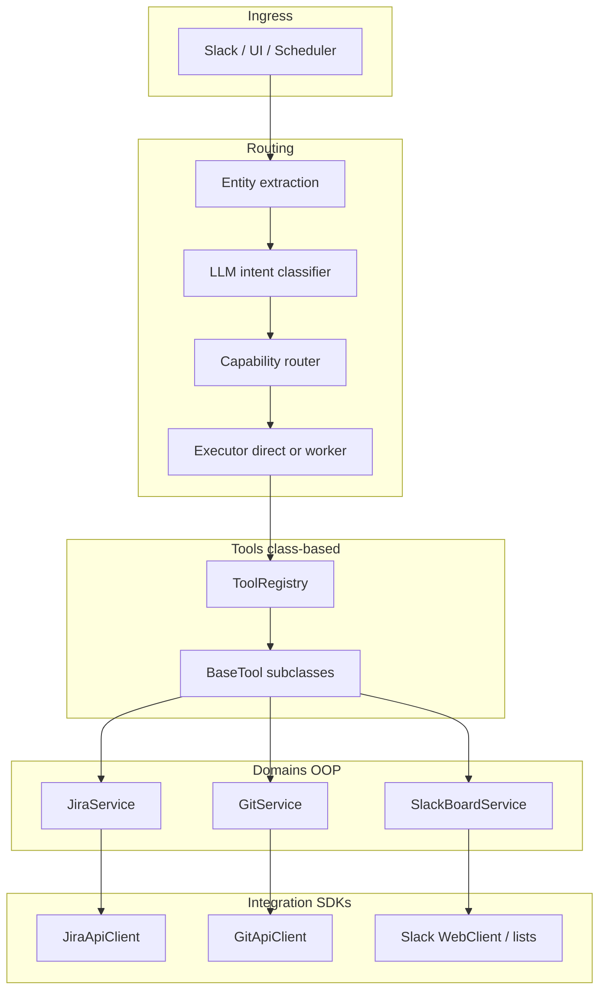

# Alfred Tools & Routing v2 — Class-Based, Capability-Driven Plan

> **Status:** Phases 1–8 (class tools, domains, hierarchical prompt routing, processor split) — 2026-08-17  
> **Supersedes (execution focus):** Phase 5+ of [`routing-and-tools-plan.md`](routing-and-tools-plan.md)  
> **Related:** [`capabilities.example.yaml`](capabilities.example.yaml) · [`implementation-status.md`](implementation-status.md) · [`request-processing.md`](request-processing.md)

## Goal

Make Alfred **structural (domain-driven), not linear** — with:

1. **Class-based tools** — one class per operation (`create`, `assign`, `transition`, …)
2. **AI + capability routing** — LLM intent classifier + capability bundles, not regex sprawl
3. **MCP-shaped surface** — internal tools and future MCP servers share the same contract
4. **Integration SDKs** — dumb HTTP/clients in `integrations/`; business logic in `domains/`

---

## Table of contents

1. [Problems with the current structure](#1-problems-with-the-current-structure)
2. [Design principles](#2-design-principles)
3. [Target architecture](#3-target-architecture)
4. [Four-layer model](#4-four-layer-model)
5. [Class-based tools (required)](#5-class-based-tools-required)
6. [Domain services](#6-domain-services)
7. [Capability routing (AI-first)](#7-capability-routing-ai-first)
8. [MCP alignment](#8-mcp-alignment)
9. [Repository layout](#9-repository-layout)
10. [Intent taxonomy](#10-intent-taxonomy)
11. [Prompt contract per turn](#11-prompt-contract-per-turn)
12. [Migration from today](#12-migration-from-today)
13. [Implementation phases](#13-implementation-phases)
14. [Success metrics](#14-success-metrics)
15. [Non-goals (this phase)](#15-non-goals-this-phase)

---

## 1. Problems with the current structure

| Problem | Where | Impact |
|---------|-------|--------|
| Procedural tools | `backend/tools/*/register.py` — `ToolSchema` + nested handler closures | Hard to test, document, or map to operations |
| Misleading registry builder | `build_git_tool_registry()` registers JIRA, Slack, Google, … | No clear domain boundary |
| Duplicate tool names | `add_jira_comment` / `jira_add_comment`, `list_jira_issues` / `jira_search` | Model picks wrong tool |
| Routing bypasses tools | `slack_board_direct.py` creates tasks without `slack_board_create_task` | JIRA requests hijacked by Slack handlers |
| Regex intent sprawl | `jira_intent.py`, `slack_board_intent.py`, `tool_planner.py`, `processor.py` | Same intent, different behavior |
| Capabilities unused as primary router | `capabilities.py` exists but routing doesn’t start there | Bundles are documentation, not control plane |
| Descriptions in 4 places | register files, `catalog_formatter.py`, skills, heuristics | Prompt drift |
| No `BaseTool` | `tools/base/` has errors/logging only | No shared validation, logging, governance hook |

**Production example:** User says *“create a task … in JIRA on TECH board”* after governance approval → Slack List direct handler runs first → *“channel not linked to a Slack List”*. Root cause: **linear processor overrides**, not missing JIRA API.

---

## 2. Design principles

1. **Class per operation** — Every LLM-callable action is a `BaseTool` subclass with a single responsibility.
2. **Capabilities, not flat tool lists** — Routing selects `jira.write.create`, then exposes only `jira_create_issue`.
3. **AI classifies, code enforces** — LLM outputs a closed `intent_class` enum; registry enforces allowlists.
4. **Regex for entities only** — Issue keys, URLs, sheet IDs, dates — not “is this JIRA or Slack?”
5. **Integrations ≠ tools** — `integrations/` = SDK/HTTP; `domains/` = verbs; `tools/` = AI surface.
6. **One resolver per turn** — `resolve_turn()` → `TurnPlan`; no duplicate logic in processor + LangGraph nodes.
7. **MCP-compatible schemas** — JSON Schema args, `tools/list` / `tools/call` semantics internally and for v3 MCP client.

---

## 3. Target architecture



---

## 4. Four-layer model

| Layer | Path | Responsibility | AI-aware? |
|-------|------|----------------|-----------|
| **L1 Integrations** | `backend/integrations/` | HTTP/SDK clients, DTOs, retries | No |
| **L2 Domains** | `backend/domains/` | Business operations: create, assign, transition | No |
| **L3 Tools** | `backend/tools/` | `BaseTool` classes, schemas, `ToolResult` | Yes |
| **L4 Routing** | `backend/routing/` | Classifier, capabilities, resolver, executor | Yes |

**Dependency rule:** `tools → domains → integrations`. Never the reverse.

---

## 5. Class-based tools (required)

### 5.1 Core abstractions

All new and migrated tools **must** use these classes (no new closure handlers).

```python
# backend/tools/base/tool.py

from abc import ABC, abstractmethod
from dataclasses import dataclass
from pathlib import Path

from backend.ai.base import ToolSchema
from backend.models.config import AlfredConfig
from backend.tools.result import ToolResult


@dataclass(frozen=True)
class ToolContext:
    """Immutable runtime context for every tool invocation."""
    config: AlfredConfig
    data_dir: Path
    task_id: str | None
    session_key: str | None
    source: str  # slack | ui | cli | scheduler
    channel_id: str | None
    thread_ts: str | None
    user_id: str | None


class BaseTool(ABC):
    """One class = one LLM tool = one domain operation."""

    name: str
    capability: str       # e.g. jira.write.create
    operation: str        # e.g. create | assign | transition
    domain: str           # e.g. jira | slack_board | git

    @abstractmethod
    def schema(self) -> ToolSchema:
        """MCP-compatible JSON Schema for arguments."""

    @abstractmethod
    def run(self, ctx: ToolContext, arguments: dict) -> ToolResult:
        """Validate args, call domain service, return structured result."""

    def description(self) -> str:
        """Single-line text for planner manifest (defaults to schema description)."""
        return self.schema().description
```

```python
# backend/tools/base/bundle.py

class ToolBundle(ABC):
    """Registers a coherent capability slice (e.g. all JIRA write tools)."""

    capability_prefix: str  # e.g. jira.write

    @abstractmethod
    def tools(self) -> list[BaseTool]:
        ...

    def tool_names(self) -> list[str]:
        return [t.name for t in self.tools()]

    def register(self, registry: ToolRegistry, ctx: ToolContext) -> None:
        for tool in self.tools():
            registry.register(tool.schema(), lambda args, t=tool: t.run(ctx, args))
```

> **Note:** Registration may use a thin lambda that closes over `ctx` until registry accepts `BaseTool` directly — end state is `registry.register_tool(tool, ctx)`.

### 5.2 Example: JIRA create (reference implementation)

```python
# backend/tools/jira/create_issue.py

from dataclasses import dataclass

from backend.domains.jira.models import CreateIssueRequest
from backend.domains.jira.service import JiraService
from backend.tools.base.tool import BaseTool, ToolContext
from backend.tools.result import ToolResult


@dataclass
class JiraCreateIssueTool(BaseTool):
    name = "jira_create_issue"
    capability = "jira.write.create"
    operation = "create"
    domain = "jira"

    def schema(self) -> ToolSchema:
        return ToolSchema(
            name=self.name,
            description="Create a new JIRA issue (Task, Story, Bug, Epic).",
            parameters={
                "type": "object",
                "properties": {
                    "project": {"type": "string", "description": "Project key, e.g. TECH."},
                    "summary": {"type": "string", "description": "Issue title."},
                    "issue_type": {"type": "string", "description": "Task, Bug, Story, …"},
                    "description": {"type": "string"},
                    "assignee": {"type": "string"},
                    "priority": {"type": "string"},
                },
                "required": ["project", "summary"],
            },
        )

    def run(self, ctx: ToolContext, arguments: dict) -> ToolResult:
        req = CreateIssueRequest.from_args(arguments)
        service = JiraService.from_config(ctx.config)
        issue = service.create_issue(req)
        return ToolResult(kind="jira_action", data=issue.to_dict())
```

### 5.3 JIRA write bundle (class composition)

| Class | Tool name | Operation | Capability |
|-------|-----------|-----------|------------|
| `JiraCreateIssueTool` | `jira_create_issue` | create | `jira.write.create` |
| `JiraAssignIssueTool` | `jira_assign_issue` | assign | `jira.write.assign` |
| `JiraTransitionIssueTool` | `transition_jira_issue` | transition | `jira.write.transition` |
| `JiraAddCommentTool` | `jira_add_comment` | comment | `jira.write.comment` |
| `JiraUpdateIssueTool` | `jira_update_issue` | update | `jira.write.update` |
| `JiraGetIssueTool` | `get_jira_issue` | read | `jira.read.single` |
| `JiraSearchTool` | `jira_search` | search | `jira.read.list` |

**Deprecate:** `add_jira_comment`, `list_jira_issues` (aliases removed after migration).

### 5.4 Slack board write bundle

| Class | Tool name | Operation | Capability |
|-------|-----------|-----------|------------|
| `SlackBoardCreateTaskTool` | `slack_board_create_task` | create | `slack.board.write.create` |
| `SlackBoardUpdateTaskTool` | `slack_board_update_task` | update | `slack.board.write.update` |
| `SlackBoardCommentTool` | `slack_board_comment` | comment | `slack.board.write.comment` |
| `SlackBoardSearchTasksTool` | `slack_board_search_tasks` | search | `slack.board.read.search` |
| `SlackBoardGetTaskTool` | `slack_board_get_task` | read | `slack.board.read.single` |

**Rule:** `slack_board_direct.py` must call `SlackBoardService` — same code path as tools.

---

## 6. Domain services

Domains encapsulate **verbs** shared by tools, direct routes, and future MCP.

```python
# backend/domains/jira/service.py

class JiraService:
    def __init__(self, client: JiraApiClient, config: JiraConfig): ...

    @classmethod
    def from_config(cls, config: AlfredConfig) -> JiraService: ...

    def create_issue(self, req: CreateIssueRequest) -> JiraIssue: ...
    def assign_issue(self, req: AssignIssueRequest) -> JiraIssue: ...
    def transition_issue(self, req: TransitionRequest) -> JiraIssue: ...
    def add_comment(self, req: CommentRequest) -> None: ...
```

```python
# backend/domains/slack_board/service.py

class SlackBoardService:
    def create_task(self, req: CreateTaskRequest) -> BoardTask: ...
    def update_task(self, req: UpdateTaskRequest) -> BoardTask: ...
    def assign_task(self, req: AssignTaskRequest) -> BoardTask: ...
```

**Integration clients stay thin:** `backend/integrations/jira/api.py` (`JiraApiClient`) remains HTTP-focused. Domain service adds project resolution, validation, and Alfred-specific defaults.

---

## 7. Capability routing (AI-first)

### 7.1 Capability map (config + code)

Extend [`backend/routing/capabilities.py`](../backend/routing/capabilities.py) to **sub-capabilities**:

```yaml
# .alfred/capabilities.yaml
capabilities:
  jira.write.create:
    domain: jira
    skill: jira_management
    tools: [jira_create_issue]
    governance: [jira_create_issue]

  jira.write.assign:
    domain: jira
    skill: jira_management
    tools: [jira_assign_issue]

  jira.write.transition:
    domain: jira
    skill: jira_management
    tools: [transition_jira_issue]

  slack.board.write.create:
    domain: slack_board
    skill: slack_board_management
    tools: [slack_fetch_thread, slack_board_create_task]

  repo.docs.qa:
    domain: repo_docs
    skill: repo_knowledge
    tools: [search_repo_docs, read_repo_doc]
```

Skills declare **`allowed_capabilities`**, not flat tool lists:

```yaml
# skills/jira_management.md (frontmatter)
allowed_capabilities:
  - jira.read.*
  - jira.write.*
```

### 7.2 Hierarchical prompt router (primary)

Two LLM hops, each constrained to a closed catalog. Implemented in `backend/routing/classifier/hierarchical.py`. Default **on** (`routing.classifier_enabled: true`).

```
1. Fetch query metadata
   source, channel, thread, Slack List binding (DB), Jira project, session turn_plan, entities
2. List enabled tool parents (jira / slack_board / git / web / …) with descriptions
3. Model picks one parent
4. List that parent's functions (name + description), grouped by capability
5. Model picks the best function (contextual + semantic match)
6. Lift function → capability → TurnPlan tools
```

**Fallbacks (not the primary router):**

| Condition | Action |
|-----------|--------|
| Message is essentially an issue key (`TECH-123`) | Skip LLM; `jira.read.single` |
| Model unavailable / invalid JSON / confidence &lt; 0.55 | Deterministic rules |
| `ambiguous_with` non-empty | Conversational route (clarify Slack List vs JIRA) |

**Regex role:** extract `TECH-123`, Google sheet URLs, `@mentions`, date ranges — **never** choose JIRA vs Slack. Old filename shims are **deleted**, not deprecated.

### 7.3 Single resolver

```python
# backend/routing/resolver.py

@dataclass(frozen=True)
class TurnPlan:
    intent_class: str
    capability: str
    target_system: str
    tools: list[str]
    route: str  # direct | worker | conversational
    entities: dict
    skill_name: str
    manifest: str


def resolve_turn(task: Task, session: ConversationSession, config: AlfredConfig) -> TurnPlan:
    entities = extract_entities(task, session)
    classification = classify_intent(task, session, entities, config)
    capability = resolve_capability(classification.intent_class, config)
    tools = intersect(capability.tools, config.enabled, skill.allowlist)
    route = choose_route(classification, tools)
    manifest = build_manifest_from_tools(tools)  # from BaseTool.description()
    return TurnPlan(...)
```

`TaskProcessor.process()` becomes: **session → resolve_turn → execute → ground**.

### 7.4 Remove over time

- Duplicate intent regex across `processor.py`, `tool_planner.py`, `slack_board_intent.py`
- Direct handlers that duplicate domain logic (merge into `domains/` + optional fast path)
- Second tool planning pass (LangGraph replans after processor plans)

---

## 8. MCP alignment

### 8.1 Internal tools = MCP-shaped

| MCP | Alfred v2 |
|-----|-----------|
| `tools/list` | `ToolBundle.tools()` → `schema()` |
| `tools/call` | `BaseTool.run(ctx, args)` |
| JSON Schema | `ToolSchema.parameters` |
| Server per domain | `JiraToolBundle`, `SlackBoardToolBundle` |

### 8.2 v3 external MCP (future)

```yaml
# .alfred/config.yaml
mcp:
  servers:
    sentry:
      command: ["npx", "-y", "@sentry/mcp-server"]
      capabilities: [observability.read]
```

External tools register through the same `ToolRegistry` with governance hooks. Built-in class-based tools remain first-party.

### 8.3 Optional: Alfred as MCP server

Expose `domains/*` as an MCP server for other agents — same `BaseTool` classes, different transport.

---

## 9. Repository layout

```
backend/
├── integrations/              # L1 — SDK/HTTP (existing, refine)
│   ├── jira/
│   │   ├── client.py          # JiraApiClient (from api.py)
│   │   └── issues.py          # raw REST helpers
│   ├── git/
│   └── slack/
│
├── domains/                   # L2 — NEW — business operations
│   ├── jira/
│   │   ├── service.py
│   │   ├── models.py
│   │   └── operations/        # optional split files
│   ├── slack_board/
│   ├── git/
│   └── google/
│
├── tools/                     # L3 — class-based AI surface
│   ├── base/
│   │   ├── tool.py            # BaseTool, ToolContext
│   │   ├── bundle.py          # ToolBundle
│   │   ├── schema.py          # validators, schema builders
│   │   ├── errors.py
│   │   └── logging.py
│   ├── jira/
│   │   ├── bundle.py          # JiraToolBundle
│   │   ├── create_issue.py
│   │   ├── assign_issue.py
│   │   └── transition_issue.py
│   ├── slack/
│   │   ├── bundle.py
│   │   └── board/
│   │       ├── create_task.py
│   │       └── update_task.py
│   ├── builder.py             # build_tool_registry() — replaces git_api.py name
│   └── catalog.py             # names + domains (unchanged role)
│
├── routing/                   # L4 — AI + capabilities
│   ├── entities/
│   ├── classifier/
│   │   ├── intent_classes.py  # closed enum
│   │   └── classify.py        # LLM structured output
│   ├── capabilities/
│   │   ├── loader.py          # from capabilities.py
│   │   └── map.yaml           # intent_class → capability
│   ├── resolver.py            # resolve_turn()
│   └── executor/
│       ├── direct.py
│       └── worker.py
│
└── orchestrator/              # thin — calls resolver + executor
```

---

## 10. Intent taxonomy

Closed enum (classifier labels). Each maps to one capability and a skill default.

| Intent class | Capability | Primary tool class |
|--------------|------------|-------------------|
| `jira.read.single` | `jira.read` | `JiraGetIssueTool` |
| `jira.read.list` | `jira.read` | `JiraSearchTool` |
| `jira.write.create` | `jira.write.create` | `JiraCreateIssueTool` |
| `jira.write.assign` | `jira.write.assign` | `JiraAssignIssueTool` |
| `jira.write.transition` | `jira.write.transition` | `JiraTransitionIssueTool` |
| `jira.write.comment` | `jira.write.comment` | `JiraAddCommentTool` |
| `slack.board.write.create` | `slack.board.write.create` | `SlackBoardCreateTaskTool` |
| `slack.board.write.update` | `slack.board.write.update` | `SlackBoardUpdateTaskTool` |
| `repo.docs.qa` | `repo.docs.read` | `SearchRepoDocsTool`, `ReadRepoDocTool` |
| `artifact.write.deck` | `artifact.write` | `SaveHtmlDeckTool`, `PublishHtmlArtifactTool` |
| `google.write.sheet` | `google.sheet.write` | `GoogleCreateSheetTool`, … |

Full table: [`routing-and-tools-plan.md` §5.2](routing-and-tools-plan.md#52-intent-taxonomy).

---

## 11. Prompt contract per turn

Generated from `TurnPlan` + registered `BaseTool` classes — not hand-edited in four files.

```markdown
## Capability: jira.write.create
## Target system: JIRA (not Slack List)
## Resolved: project=TECH

### Tools
- **jira_create_issue** — Create a JIRA issue.
  - Required: project, summary
  - Optional: issue_type, description, assignee, priority

Do not call Slack board tools this turn.
```

---

## 12. Migration from today

| Current | v2 |
|---------|-----|
| `tools/jira/register.py` monolith | Split into `tools/jira/*.py` classes |
| `build_git_tool_registry()` | `tools/builder.build_tool_registry(capabilities=...)` |
| `slack_board_direct.py` create logic | `SlackBoardService.create_task()` |
| `catalog_formatter._TOOL_DESCRIPTIONS` | `BaseTool.description()` |
| Skill `allowed_tools: [...]` | Skill `allowed_capabilities: [...]` |
| `create_target_precedence.py` | Classifier + `target_system` in `TurnPlan` |
| LangGraph + processor dual bootstraps | `executor/worker.py` only |

**Order:** JIRA write classes first (highest production pain), then Slack board, then Git write, then artifacts.

---

## 13. Implementation phases

### Phase 0 — Guardrails (done / in progress)

- [x] Create-target precedence (JIRA vs Slack List)
- [x] This planning document

### Phase 1 — Class foundation (2–3 weeks)

- [x] Add `BaseTool`, `ToolContext`, `ToolBundle` in `tools/base/`
- [x] Add `domains/jira/service.py` wrapping `JiraApiClient`
- [x] Migrate **class-based**: `JiraCreateIssueTool`, `JiraAssignIssueTool`, `JiraTransitionIssueTool` (plus comment/update/link/read)
- [x] Unit tests per tool class (no full registry)
- [x] Deprecate `add_jira_comment` → keep `jira_add_comment` only (alias class still registered)
- [x] Feature flag: `routing.classifier_enabled`

### Phase 2 — Resolver + classifier (2–3 weeks)

- [x] `intent_classes.py` closed enum
- [x] `classify.py` — rules always; LLM structured output when flag on
- [x] `resolve_turn()` wired in `TaskProcessor`
- [x] Capabilities: `intent_class → capability → tools` (built-in bundles + `tools_for_capability`)
- [x] Skills: `allowed_capabilities` in frontmatter
- [x] Slack board tools → `SlackBoardService` (shared with class tools; direct handlers still exist)

### Phase 3 — Domain completion (tools first, then layers)

**3a — Remaining tools on `FunctionTool`**

- [x] Git API / local / write / Graphify → `FunctionTool` + git bundles
- [x] Google sheets + docs → `FunctionTool` + Google bundles
- [x] AWS Athena / CloudWatch → `FunctionTool` + `AwsToolBundle`
- [x] Company scripts + web search + Slack read → same pattern
- [x] Register every bundle in `iter_tool_bundles()`
- [x] Delete `tools/git_api.py` shim; tests import `tools.git.api` / `tools.builder`
- [ ] Optional thin `domains/git` and `domains/google` if write logic is more than a client call

**3b — Integrations + routing folders**

- [x] Move Slack List verbs out of `integrations/slack/board_service.py` into `domains/slack_board` (integrations stay HTTP)
- [x] Stop `domains/` importing `routing/` (board formatting lives in `domains/slack_board/formatting.py`)
- [x] Group `routing/slack_board_*.py`, `git_*.py`, `jira_*.py` into subpackages (Phase 7)
- [x] Direct handlers call domain services only (Slack board create/update via `domains.slack_board.operations`)
- [x] Delete empty leftover packages: `backend/{git,github,google,jira,slack,ollama}` (pycache only)

**3c — Orchestrator (after 3b)**

- [x] Split `processor.py` into `orchestrator/processor/{core,session,direct,investigation,reply,helpers}.py`
- [x] Hierarchical prompt router is the primary classifier (parent → function → capability)
- [x] Delete old routing filename shims (`slack_board_intent.py`, `git_direct.py`, `tools/git_api.py`, …)
- [ ] LangGraph remains the investigation path; processor becomes a thinner turn owner — still later
- [ ] Single worker executor (delete processor/node duplication) — still later

### Phase 4 — MCP client (v3, 3–4 weeks)

- [ ] MCP `tools/list` → register external `BaseTool` proxies
- [ ] Admin UI for MCP servers
- [ ] Governance on MCP write tools

---

## 14. Success metrics

| Metric | Target |
|--------|--------|
| Wrong-domain creates (JIRA vs Slack) | 0 in acceptance tests |
| Tasks with logged `intent_class` + `capability` | ≥ 90% |
| Tools implemented as `BaseTool` subclasses | 100% of write tools |
| Duplicate tool names in catalog | 0 |
| New integration without editing `processor.py` | Required |
| Tool unit tests without agent loop | Every write tool class |

**Acceptance tests:**

1. *“create task … in JIRA on TECH board”* → `jira.write.create` → `jira_create_issue` only  
2. *“create task on the board”* (linked channel) → `slack.board.write.create`  
3. Ambiguous *“create a task for coupon freebie”* → clarifying question, not wrong handler  
4. After governance approval for JIRA, follow-up create stays on JIRA  

---

## 15. Non-goals (this phase)

- Replacing `JiraApiClient` with official Atlassian Python SDK (optional later; domain layer isolates transport)
- User-supplied arbitrary Python plugins
- Running untrusted MCP servers without admin config review
- Removing LangGraph — it stays as executor state machine, fed by `TurnPlan` only

---

## References

- Original comprehensive plan: [`routing-and-tools-plan.md`](routing-and-tools-plan.md)
- Capability bundle example: [`capabilities.example.yaml`](capabilities.example.yaml)
- Implementation status (update when Phase 1 starts): [`implementation-status.md`](implementation-status.md)
- MCP v3 sketch: [`../build-reference/building_phase_v0.md`](../build-reference/building_phase_v0.md#v3--tool-extensibility-next-phase--not-started)
