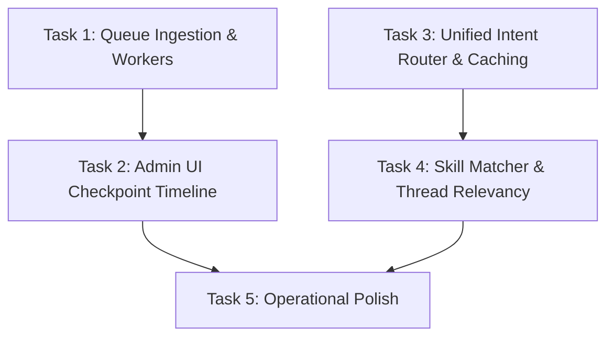
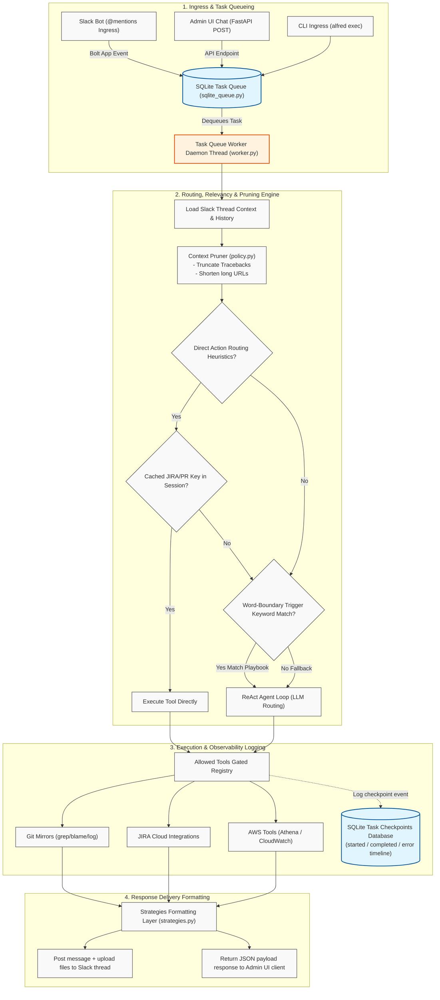

# Alfred — v0 Build Status & Gaps

> **Purpose:** Living tracker of implementation progress against [`v0.md`](v0.md) and [`idea.md`](idea.md).  
> **Update this file** when layers ship or priorities change.  
> **Last reviewed:** 2026-06-21

---

## Summary

Alfred is **directionally aligned** with the v0 architecture: local-first, pluggable AI, Slack ingress, session memory, Markdown playbooks, read-only git investigation, JIRA, **AWS (Athena + CloudWatch + grade_events)**, Graphify, and observability with cost estimates.

| v0 first milestone | Status |
|--------------------|--------|
| `alfred init → configure AI → @alfred in Slack → read-only git investigation in a thread` | **Done** |
| `@alfred` JIRA ticket queries in thread | **Mostly done** |
| AWS read tools (Athena, CloudWatch, domain event tables) | **Done** |
| GitHub App PR comment bot (`@alfred review` on PRs) | **Done** when company configures a public host (e.g. `alfred.yourcompany.dev`) |
| Small-company distributable product | **Partial** — Docker, admin UI, docs; git write ops deferred to **v2** |

---

## Roadmap labels

Use these when reading gaps below:

| Label | Meaning |
|-------|---------|
| **v0** | Shipped or in scope for current alpha |
| **v0.1** | Next polish pass — pick soon |
| **v1** | Next major increment (queue, governance) |
| **v2** | Later — write git, extra AWS surface |
| **Won't do** | Explicitly out of scope |

---

## Phase map (from v0 §7)

| Phase | Focus | Status | Target |
|-------|--------|--------|--------|
| **0** | Scaffold, config, `alfred init` | ✅ Done | v0 |
| **1** | AI plug layer | ✅ Done | v0 |
| **2** | Skills engine | ✅ Done | **v0.1** — word-boundary trigger keywords mapping |
| **3** | Slack ingress | ✅ Done | v0 — channel `@mentions` only; **Slack DMs: Won't do** |
| **4** | Thread context | ✅ Done | **v0.1** — stack trace and URL context pruning |
| **5** | Investigation + ReAct + read tools | ✅ Done | v0 read paths done; **v0.1** intent router |
| **6** | Workflow skills (write git, governance) | 🟡 Partial | JIRA writes exist; git writes **v2**; governance **v1** |
| **7** | AWS + admin UI | ✅ Mostly done | v0 — Athena/CloudWatch/grade_events; ECS/S3 tools **v2** |
| **8** | Distribution | 🟡 Partial | v0 — Docker, README, ECS/EC2 patterns |

**Legend:** ✅ Done · 🟡 Partial

---

## Layer-by-layer

### Layer 1 — Ingress

| Component | Status | Target | Notes |
|-----------|--------|--------|-------|
| `Task` model | ✅ | v0 | `backend/models/task.py` |
| Event sanitizer | ✅ | v0 | `backend/ingress/sanitize.py` |
| CLI `alfred exec` | ✅ | v0 | `backend/cli.py` |
| Slack `app_mention` | ✅ | v0 | `backend/slack/listener.py` — **supported ingress** |
| Slack DM / App Home Chat | ⛔ Won't do | — | Use `@alfred` in channels |
| GitHub App webhook | ✅ | v0 | Works when `github.callback_base_url` points at a public host (e.g. `alfred.abc.dev`); each company uses their subdomain + tunnel/ALB |
| HTTP enqueue queue (fast ack + worker) | ✅ | **v0.1** | Persistent SQLite queue; integrated into Slack listeners and API routes |

### Layer 2 — Config & Admin

| Component | Status | Target | Notes |
|-----------|--------|--------|-------|
| `alfred init` | ✅ | v0 | Interactive admin credentials configuration, CLI options |
| Encrypted secrets | ✅ | v0 | |
| Admin UI | ✅ | v0 | Flat sharp Theme 2.0 aesthetics with logout |
| Admin UI & API Auth | ✅ | v0 | Password + token auth (Basic, Bearer, X-Alfred-Token) |
| Health checks | 🟡 | v0 | Slack, Ollama, Git, JIRA, AWS STS |
| Observability | ✅ | v0 | Tokens, est. cost, tools, users |

### Layer 3 — Orchestration

| Component | Status | Target | Notes |
|-----------|--------|--------|-------|
| Task queue (durable) | ✅ | **v0.1** | Persistent SQLite queue with background worker daemon and checkpoint logging |
| Session store | ✅ | v0 | SQLite `(channel, thread_ts)` |
| Intent router | 🟡 Mostly | **v0.1** | Direct router fallback caching (active PR & JIRA tickets) |
| Git / JIRA session context | ✅ | v0 | |
| Identity map | ✅ | v0 | |

### Layer 4 — Context engine

| Component | Status | Target | Notes |
|-----------|--------|--------|-------|
| Skill / playbook matcher | ✅ | **v0.1** | Word-boundary checking triggers |
| Slack thread + channel fetch | ✅ | v0 | 30-day default |
| Relevancy heuristics | ✅ | **v0.1** | Truncate/prune long stack traces and URLs |
| Repo context + Graphify | ✅ | v0 | |
| Context policy | ✅ | v0 | |

### Layer 5 — AI layer

| Component | Status | Target | Notes |
|-----------|--------|--------|-------|
| LLM adapters | ✅ | v0 | |
| Per-task routing | ✅ | v0 | |
| Instrumentation | ✅ | v0 | |
| Synthesis on max steps | ✅ | v0 | |

### Layer 6 — Execution (tools)

| Component | Status | Target | Notes |
|-----------|--------|--------|-------|
| ReAct agent loop | ✅ | v0 | |
| Git read tools | ✅ | v0 | |
| JIRA tools | ✅ | v0 | |
| AWS tools (Athena, CloudWatch, grade_events) | ✅ | v0 | |
| Graphify `query_graph` | 🟡 | v0 | Optional, `graphify_enabled` |
| Git write tools | ❌ | **v2** | checkout, cherry-pick, open PR |
| ECS / S3 direct tools | ❌ | **v2** | In `allowed_services` config only |
| Structured UI payloads | ✅ | v0 | |

### Layer 7 — Governance

| Component | Status | Target | Notes |
|-----------|--------|--------|-------|
| Skills + playbooks | ✅ | v0 | |
| AWS guardrails | ✅ | v0 | |
| Policies, confirmation UX, audit log | ❌ | **v1** | Observability events only today |

---

## Shipped skills (`skills/`)

| Skill | Mode | Tools / purpose |
|-------|------|-----------------|
| `investigate_bug.md` | investigation | git read, get_pr, query_graph, … |
| `review_pr.md` | investigation | PR review + diff |
| `git_status.md` | workflow | list PRs, repos |
| `summarize_bugs.md` | conversational | Slack alert summaries |
| `jira_management.md` | investigation | JIRA CRUD + identity map |
| `jira_ticket.md` | investigation | Link PRs to JIRA |
| `aws_query.md` | investigation | athena_query, cloudwatch_query, list_cloudwatch_log_groups |

Company investigation playbooks (e.g. event dumps) → `.alfred/playbooks/` with `allowed_tools`.

---

## What works today (user-visible)

- `@alfred` in **Slack channels** (not app DM window)
- Thinking status + custom workspace emoji lines; `alfred slack emojis`
- Channel + thread history (30-day window)
- Domain playbooks from `.alfred/playbooks/`
- Git: PRs, review, grep/read/blame in mirrored repos
- JIRA: search/get/update/comment/create, assignee map, identity map
- AWS: Athena, CloudWatch Logs, grade_events (guardrailed)
- Structured Slack/UI rendering for AWS and grade_events
- Graphify optional on sync
- Admin UI: Chat, Usage, Health (secured behind username/password/token auth)
- Modern Theme 2.0 aesthetics with flat minimalistic style, sharp corners, and SVG line charts
- GitHub App: `@alfred review` on PR comments when public URL is configured

---

## Known gaps by target release

### v0.1 — pick soon

1. **Unified intent router** — replace growing `detect_*` direct routes
2. **Thread relevancy** — rank/filter Slack messages before LLM
3. **Skill / playbook matcher** — BM25 or strict single-skill selection (upgrade from keywords)

### v1

4. **HTTP enqueue queue** — fast ack + background worker (webhooks, recovery)
5. **Durable task queue** — wire existing ABC; crash-safe processing
6. **Governance** — policies, confirmation UX for writes, audit export

### v2

7. **Git write tools** — checkout, cherry-pick, PR create
8. **ECS / S3 direct tools** — beyond Athena/CloudWatch

### Won't do

- **Slack DM / App Home Chat** — channel `@mentions` remain the supported path

---

## Recommended next build steps (v0.1)

Below is the sequenced build plan with task dependencies:

### Detailed Execution Flow & Routing Mechanism

Here is a detailed trace of how tasks flow through Alfred from ingress to response delivery:

### 1. Task 1: Queue Ingestion & Asynchronous Workers (Core Infrastructure)
* **Status**: ✅ Shipped (SQLite queue integrated with Slack listener and UI API endpoints; executed by background TaskQueueWorker)
* **Dependencies**: None
* **Goal**: Wire the new SQLite Task Queue (`sqlite_queue.py`) into Slack and API ingress routes. Defer execution to background workers that dequeue tasks, run the `TaskProcessor`, and log checkpoint progress.

### 2. Task 2: Admin UI Checkpoint Timeline & Observability (Observability)
* **Status**: ✅ Shipped (SQLite log checkpoints table persistence and GET `/api/observability/checkpoints` routing API endpoints fully implemented)
* **Dependencies**: Task 1 (requires worker to generate sqlite checkpoint records)
* **Goal**: Build API endpoints and a React frontend timeline component in the Admin UI showing task queue states, status (`started`, `completed`, `error`), execution durations, and error stacktraces.

### 3. Task 3: Unified Intent Router & Caching (Routing)
* **Status**: ✅ Shipped (Unified JIRA key context session caching, argument fallback enrichment, prompt injection, and direct actions updated)
* **Dependencies**: None
* **Goal**: Refactor `backend/routing/engine.py` and `intent.py` to leverage a unified, semantic routing strategy. Cache active entities (e.g. target JIRA tickets or PR numbers) per Slack thread to avoid redundant user lookups.

### 4. Task 4: Skill Matcher & Thread Relevancy (Heuristics)
* **Status**: ✅ Shipped (Alphanumeric word-boundary keyword checks and context pruning helper `prune_context` completed)
* **Dependencies**: Task 3 (requires clean intent detection)
* **Goal**: Implement context pruning heuristics in `backend/orchestrator/policy.py` to strip out long stack traces and URLs from previous messages before feeding context to the LLM. Upgrade keyword trigger matching to a hybrid keyword + semantic similarity model.

### 5. Task 5: Operational Polish (UX & Integration)
* **Status**: ❌ Not started
* **Dependencies**: Task 2, Task 4
* **Goal**: Add hooks for `users:read.email` for richer assignee mapping, configure fallback strategies for unrouted queries, and optimize the prompt instructions for specific models (Claude, Kimi).

Defer until v1: confirmation governance. Defer until v2: git writes, ECS/S3.

---

## Architectural decisions

| Decision | Rationale |
|----------|-----------|
| Channel `@mentions` only | No Slack app DM support — simpler ingress, matches team usage |
| Public URL per company for GitHub App | Webhook needs HTTPS; e.g. `alfred.abc.dev` + Cloudflare tunnel or ALB |
| Playbooks local, skills in repo | Company tables/rules stay private |
| Socket Mode for Slack | No public URL required for Slack |
| Direct processor paths (temporary) | Until v0.1 unified intent router |
| grade_events in playbooks | Company table semantics; tool enforces guardrails |

---

## Doc hygiene — what is committable?

| Path | Commit? | Notes |
|------|---------|-------|
| **`building_phase_v0.md`** (this file) | **Yes** | Shared implementation tracker |
| `docs/build-reference/v0.md`, `idea.md` | **Yes** | Architecture references |
| `docs/build-reference/**/*.html` | **No** | Gitignored — local browser exports (e.g. `building_phase_v0.html`) |
| `docs/build-reference/building_phase_*` except `v0.md` | **No** | Gitignored — personal scratch trackers |
| `docs/build-reference/scratch/` | **No** | Gitignored |
| `.alfred/` | **No** | Gitignored — secrets, playbooks, mirrors |

Regenerate HTML locally for reading; do not commit HTML exports.

---

## References

- [`v0.md`](v0.md) — layer architecture
- [`idea.md`](idea.md) — original blueprint
- [`README.md`](../../README.md) — user-facing setup
- Code: `backend/slack/listener.py`, `backend/ingress/processor.py`, `backend/github/handler.py`, `backend/tools/aws_tool.py`
