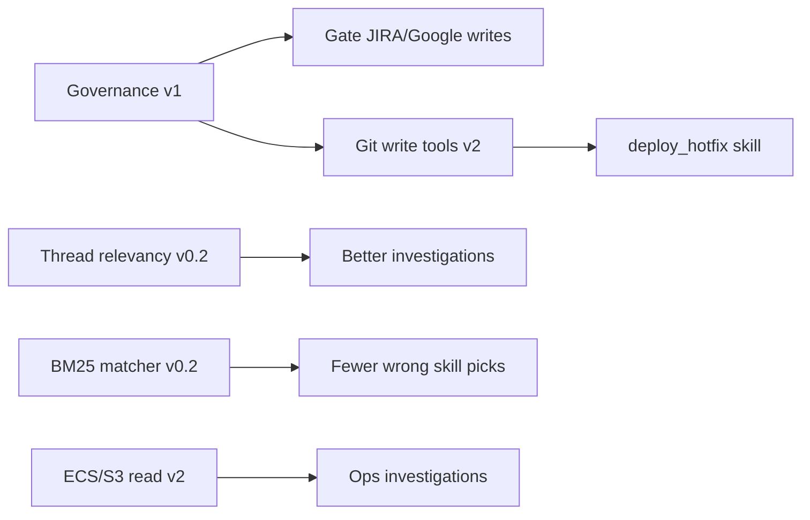
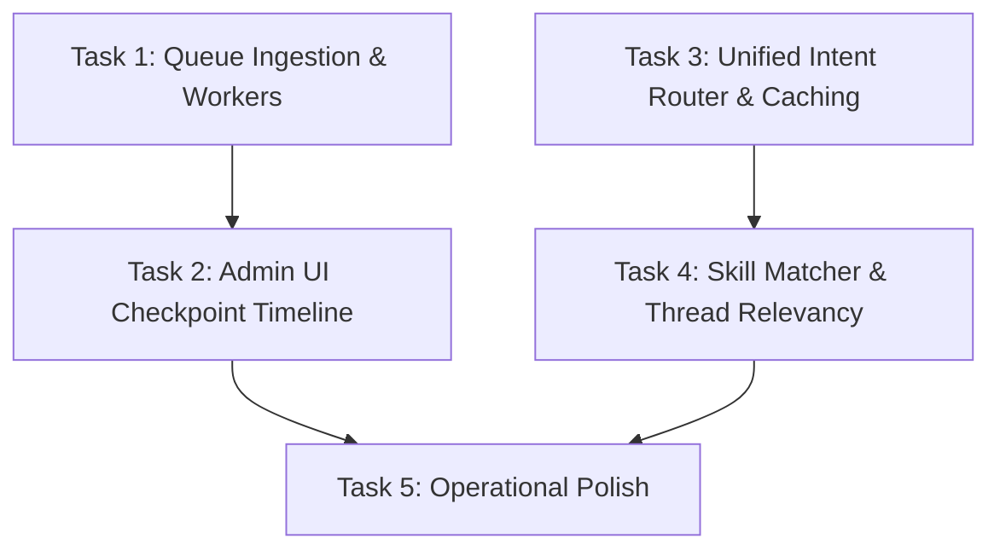
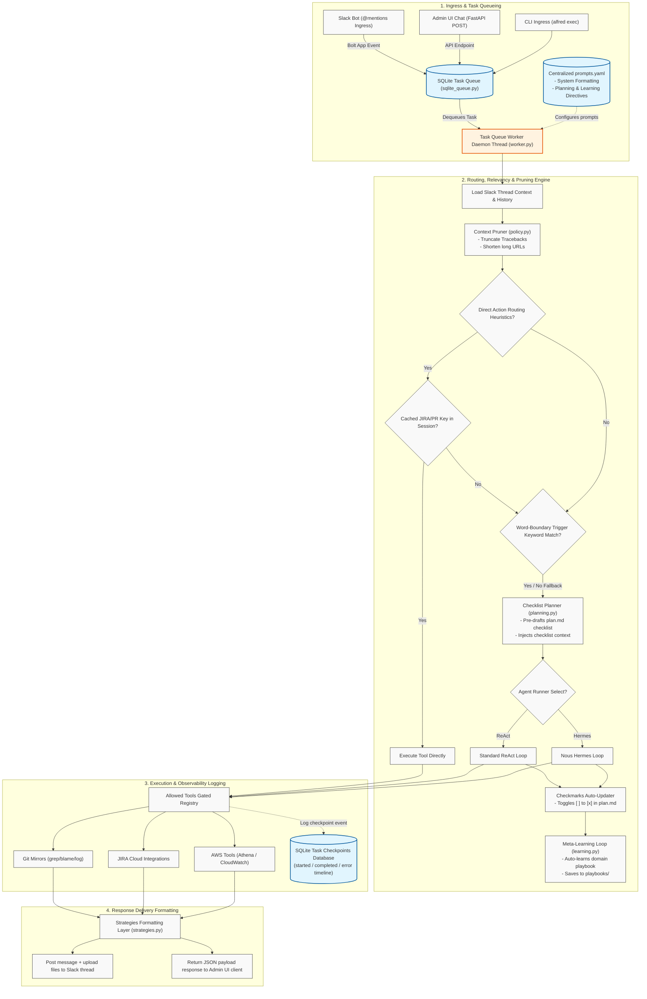

# Alfred — v0 Build Status & Gaps

> **Purpose:** Living tracker of implementation progress against [`v0.md`](v0.md) and [`idea.md`](idea.md).  
> **Update this file** when layers ship or priorities change.  
> **Last reviewed:** 2026-07-18

---

## Summary

Alfred is **directionally aligned** with the v0 architecture: local-first, pluggable AI, Slack ingress, session memory, Markdown playbooks, read-only git investigation, JIRA (**including writes**), Google Workspace (**including writes**), **AWS (Athena + CloudWatch + grade_events)**, Graphify, cron schedules, planning mode, self-learning playbooks, and observability with cost estimates.

**v0.1 routing/queue polish is shipped.** Remaining work clusters into **context/routing polish (v0.2)**, and **git/AWS write surface (v2)** — governance v1 and plan→PR handoff are shipped; see [Recommended next build steps](#recommended-next-build-steps).

| v0 first milestone | Status |
|--------------------|--------|
| `alfred init → configure AI → @alfred in Slack → read-only git investigation in a thread` | **Done** |
| `@alfred` JIRA ticket queries in thread | **Done** (with session ticket caching) |
| AWS read tools (Athena, CloudWatch, domain event tables) | **Done** |
| GitHub App PR comment bot (`@alfred review` on PRs) | **Done** when company configures a public host (e.g. `alfred.yourcompany.dev`) |
| Small-company distributable product | **Done** — Docker, admin UI, docs, SQLite queues, self-improving playbooks |

---

## Roadmap labels

Use these when reading gaps below:

| Label | Meaning |
|-------|---------|
| **v0** | Shipped — current alpha baseline |
| **v0.1** | Shipped — queue, unified router, keyword/heuristic/LLM routing, context pruning |
| **v0.2 polish** | Next — thread relevancy ranking, BM25 matcher, self-learning review gate |
| **v1** | Governance — audit log, confirmation UX, write policies |
| **v2** | Git write tools, ECS/S3 tools, workflow skills (e.g. hotfix) |
| **Won't do** | Explicitly out of scope |

---

## Phase map (from v0 §7)

| Phase | Focus | Status | Target |
|-------|--------|--------|--------|
| **0** | Scaffold, config, `alfred init` | ✅ Done | v0 |
| **1** | AI plug layer | ✅ Done | v0 |
| **2** | Skills engine | ✅ Done | v0.1 — keyword + heuristic + LLM routing |
| **3** | Slack ingress | ✅ Done | v0 — channel `@mentions` only; **Slack DMs: Won't do** |
| **4** | Thread context | 🟡 Partial | v0 fetch + prune done; **v0.2** message relevancy ranking |
| **5** | Investigation + ReAct + read tools | ✅ Done | v0 read paths; Hermes loop optional |
| **6** | Workflow skills (write git, governance) | 🟡 Partial | JIRA + Google writes exist ungated; git writes **v2**; governance **v1** |
| **7** | AWS + admin UI | ✅ Done | v0 — Athena/CloudWatch/grade_events; ECS/S3 tools **v2** |
| **8** | Distribution | ✅ Done | v0 — Docker, README, ECS/EC2 patterns, SQLite queue |

**Legend:** ✅ Done · 🟡 Partial

---

## Layer-by-layer

### Layer 1 — Ingress

| Component | Status | Target | Notes |
|-----------|--------|--------|-------|
| `Task` model | ✅ | v0 | `backend/models/task.py` |
| Event sanitizer | ✅ | v0 | `backend/ingress/sanitize.py` |
| CLI `alfred exec` | ✅ | v0 | `backend/cli.py` |
| Slack `app_mention` | ✅ | v0 | `backend/slack/listener.py` — **supported ingress** |
| Slack DM / App Home Chat | ⛔ Won't do | — | Use `@alfred` in channels |
| GitHub App webhook | ✅ | v0 | Works when `github.callback_base_url` points at a public host (e.g. `alfred.abc.dev`); each company uses their subdomain + tunnel/ALB |
| HTTP enqueue queue (fast ack + worker) | ✅ | **v0.1** | Persistent SQLite queue; integrated into Slack listeners and API routes |

### Layer 2 — Config & Admin

| Component | Status | Target | Notes |
|-----------|--------|--------|-------|
| `alfred init` | ✅ | v0 | Interactive admin credentials configuration, CLI options |
| Encrypted secrets | ✅ | v0 | |
| Admin UI | ✅ | v0 | Flat sharp Theme 2.0 aesthetics with logout |
| Admin UI & API Auth | ✅ | v0 | Password + token auth (Basic, Bearer, X-Alfred-Token) |
| Health checks | 🟡 | v0 | Slack, Ollama, Git, JIRA, AWS STS, web search |
| Observability | ✅ | v0 | Tokens, est. cost, tools, users |

### Layer 3 — Orchestration

| Component | Status | Target | Notes |
|-----------|--------|--------|-------|
| Task queue (durable) | ✅ | **v0.1** | Persistent SQLite queue with background worker daemon and checkpoint logging |
| Session store | ✅ | v0 | SQLite `(channel, thread_ts)` |
| Intent router | ✅ | **v0.1** | Unified `detect_direct_action` in `routing/intent.py`; session PR/JIRA cache |
| Git / JIRA session context | ✅ | v0 | |
| Identity map | ✅ | v0 | |
| Cron scheduler | ✅ | v0 | `runtime/scheduler.py` + `schedule_management` skill |

### Layer 4 — Context engine

| Component | Status | Target | Notes |
|-----------|--------|--------|-------|
| Skill / playbook matcher | ✅ | **v0.2 polish** | Keyword + heuristic + **BM25** + LLM (`routing/engine.py`) |
| Slack thread + channel fetch | ✅ | v0 | 90-day default (with relative day/week regex time window parser) |
| Context pruning | ✅ | **v0.1** | `prune_context()` — truncate stack traces and long URLs |
| Thread relevancy ranking | ✅ | **v0.2 polish** | Heuristic ranker keeps top N thread messages + omission summary (`slack/relevancy.py`) |
| Repo context + Graphify | ✅ | v0 | |
| Context policy | ✅ | v0 | |

### Layer 5 — AI layer

| Component | Status | Target | Notes |
|-----------|--------|--------|-------|
| LLM adapters | ✅ | v0 | |
| Per-task routing | ✅ | v0 | |
| Instrumentation | ✅ | v0 | |
| Synthesis on max steps | ✅ | v0 | |

### Layer 6 — Execution (tools)

| Component | Status | Target | Notes |
|-----------|--------|--------|-------|
| ReAct agent loop | ✅ | v0 | |
| Git read tools | ✅ | v0 | |
| JIRA tools | ✅ | v0 | |
| AWS tools (Athena, CloudWatch, grade_events) | ✅ | v0 | |
| Graphify `query_graph` | 🟡 | v0 | Optional, `graphify_enabled` |
| Google Workspace tools | ✅ | v0 | Sheets read/write, Docs read/create/append |
| Web search (`web_search`) | ✅ | **v0.2 polish** | DuckDuckGo (optional `uv sync --extra web`) or Tavily; `web_research` skill |
| Schedule tools | ✅ | v0 | `create_schedule`, `list_schedules`, … |
| Git write tools | 🟡 Phase 1 | **v2** | Branch/commit/push/PR + debug scripts when `git.write_enabled`; full hotfix skills **v2** |
| ECS / S3 direct tools | ❌ | **v2** | In `allowed_services` config only — no boto tools yet |
| Structured UI payloads | ✅ | v0 | |

### Layer 7 — Governance

| Component | Status | Target | Notes |
|-----------|--------|--------|-------|
| Skills + playbooks | ✅ | v0 | |
| AWS guardrails | ✅ | v0 | |
| Policies, confirmation UX, audit log | ✅ | **v1** | `GovernanceContext` on `ToolRegistry.run()`; SQLite `audit_log`; Slack/UI confirmation before push/PR/JIRA/Google/schedules |
| Self-learning playbook review | ✅ | **v0.2 polish** | Pending queue in `.alfred/pending_playbooks.json`; approve/reject in Playbooks admin UI |
| Lazy skill index | ✅ | **v0.2 polish** | Metadata-first `PlaybookStore`; bodies load on match; shared store + admin invalidation |
| Lazy tool registration | ✅ | **v0.2 polish** | `build_git_tool_registry(allowed_tools=…)` skips unused integration modules/handlers |

---

## Shipped skills (`skills/`)

| Skill | Mode | Tools / purpose |
|-------|------|-----------------|
| `investigate_bug.md` | investigation | git read, get_pr, query_graph, web_search, … |
| `review_pr.md` | investigation | PR review + diff |
| `git_status.md` | workflow | list PRs, repos |
| `summarize_bugs.md` | conversational | Slack alert summaries |
| `jira_management.md` | investigation | JIRA CRUD + identity map |
| `jira_ticket.md` | investigation | Link PRs to JIRA |
| `aws_query.md` | investigation | athena_query, cloudwatch_query, list_cloudwatch_log_groups |
| `google_workspace.md` | investigation | Google Sheets/Docs read/write |
| `web_research.md` | investigation | External docs/errors via `web_search` |
| `schedule_management.md` | workflow | Cron schedule CRUD |
| `create_pr.md` | workflow | Phase 1 PR flow — branch, write, draft PR (`git.write_enabled`) |

Company investigation playbooks (e.g. event dumps) → `.alfred/playbooks/` with `allowed_tools`.

---

## What works today (user-visible)

- `@alfred` in **Slack channels** (not app DM window)
- Thinking status + custom workspace emoji lines; `alfred slack emojis`
- Channel + thread history (90-day window with dynamic day/week range queries)
- **Checklist Planning Mode**: Alfred pre-plans complex tasks into checklist files (`.alfred/plans/plan_<task_id>.md`) and executes step-by-step
- **Self-Improving Playbooks**: Reflects on successful paths and auto-saves new playbooks to `.alfred/playbooks/`
- Domain playbooks from `.alfred/playbooks/`
- Git: PRs, review, grep/read/blame in mirrored repos
- JIRA: search/get/update/comment/create, assignee map, identity map
- Google Workspace: Sheets/Docs via OAuth or service account
- Web search: `web_search` tool (DuckDuckGo or Tavily) for external docs and errors — opt-in under Integrations
- Cron schedules: background jobs enqueue tasks to Slack channels
- AWS: Athena, CloudWatch Logs, grade_events (guardrailed)
- Structured Slack/UI rendering for AWS and grade_events
- Graphify optional on sync
- Admin UI: Chat, Usage, Health (secured behind username/password/token auth)
- Modern Theme 2.0 aesthetics with flat minimalistic style, sharp corners, and SVG line charts
- GitHub App: `@alfred review` on PR comments when public URL is configured

---

## Known gaps by target release

### v0.1 — shipped ✅

| Item | Code | Notes |
|------|------|-------|
| SQLite task queue + worker | `db/sqlite_queue.py`, `orchestrator/worker.py` | Fast ack; checkpoints in observability DB |
| Unified intent router | `routing/intent.py` → `detect_direct_action` | JIRA, git, investigate direct paths |
| Skill routing | `routing/engine.py` | Keyword → heuristic → LLM (`agentic_routing`) |
| Context pruning | `orchestrator/policy.py` → `prune_context` | Stack traces + long URLs — **not** message ranking |

### v0.2 polish — next (quality, no new integrations)

| # | Gap | Why it matters |
|---|-----|----------------|
| 1 | **Thread relevancy ranking** | Long Slack threads still send most messages to the LLM after prune-only compression |
| 2 | **BM25 playbook matcher** | Planned in `v0.md` but never added; keyword collisions possible when many playbooks overlap |
| 3 | **Self-learning review gate** | `learning.py` writes playbooks directly — needs Admin UI approve/reject before activation |

**Thread relevancy (design sketch):** score messages by stack traces, file paths, error codes, PR/commit URLs, keyword overlap with intent, recency; keep top N + one-line summary of the rest. Optional cheap-model pass before investigation LLM.

**BM25 (design sketch):** index playbook `name`, `description`, and triggers locally (`rank-bm25`); use as tier between keyword and LLM matcher when confidence is ambiguous.

### v1 — governance (shipped)

| # | Item | Status |
|---|------|--------|
| 4 | **Audit log** | ✅ SQLite `audit_log` table + `GET /api/observability/audit` |
| 5 | **Confirmation UX** | ✅ Reply *yes, proceed* in-thread → 30 min write approval (Slack/UI; CLI excluded by default) |
| 6 | **Write policies** | ✅ Blocked channels, allowed users, source allowlist via `governance` config + Admin UI |
| 7 | **Gate existing writes** | ✅ Push, PR, JIRA, Google, and schedule tools require confirmation when governance enabled |

Local git staging (`write_file`, `git_commit`, …) is **audit-logged** but does not require confirmation — reversible until push.

### v2 — automation surface

| # | Gap | Notes |
|---|-----|-------|
| 8 | **Git write tools** | `git_create_branch`, `git_push` (no `main`/`master`), `create_pr`; workspace-scoped only |
| 9 | **`deploy_hotfix.md` skill** | Described in `v0.md` / `idea.md` — not shipped in `skills/` |
| 10 | **ECS / S3 read tools** | `allowed_services` lists them; only Athena + CloudWatch tools exist |

Safe git write slice: branch in session workspace → push branch → open PR via existing GitHub/GitLab API clients. **No force-push tool.**

### Operational polish (ongoing)

| Area | Gap |
|------|-----|
| Health checks | Slack/Git/JIRA/AWS/Google/web search/Ollama tracked in admin UI; add queue depth, scheduler heartbeat, mirror freshness |
| Horizontal scale | Single worker thread — fine for small teams; multi-worker needs lease-based dequeue |
| Tests | Thin coverage on Google tool E2E, schedule→queue→processor path; governance unit tests in `tests/test_governance.py` |
| Docs | Keep `building_phase_v0.md` ↔ `README.md` in sync when shipping |

### Won't do

- **Slack DM / App Home Chat** — channel `@mentions` remain the supported path

---

## Recommended next build steps

Suggested sequence (pick one track based on team priority):

| Track | Best for | Steps |
|-------|----------|-------|
| **Safe automation** | Hotfix/cherry-pick workflows | v1 governance → git branch/push/PR tools → `deploy_hotfix.md` |
| **Better debug UX** | Long Slack incident threads | Thread relevancy ranking → optional BM25 matcher |
| **Ops depth** | ECS/S3 investigation | ECS/S3 read tools (after or in parallel with v1) |

**Recommended default:** BM25 matcher and self-learning review gate are shipped. Next: ECS/S3 read tools, company playbooks, or real-repo plan→PR dry run — defer deploy/hotfix skills until CI/CD integrations (Jenkins, Argo, etc.) are scoped.

---

## Completed v0.1 work (archive)

Below is the sequenced build plan with task dependencies:

### Detailed Execution Flow & Routing Mechanism

Here is a detailed trace of how tasks flow through Alfred from ingress to response delivery:

### 1. Task 1: Queue Ingestion & Asynchronous Workers (Core Infrastructure)
* **Status**: ✅ Shipped (SQLite queue integrated with Slack listener and UI API endpoints; executed by background TaskQueueWorker)
* **Dependencies**: None
* **Goal**: Wire the new SQLite Task Queue (`sqlite_queue.py`) into Slack and API ingress routes. Defer execution to background workers that dequeue tasks, run the `TaskProcessor`, and log checkpoint progress.

### 2. Task 2: Admin UI Checkpoint Timeline & Observability (Observability)
* **Status**: ✅ Shipped (SQLite log checkpoints table persistence and GET `/api/observability/checkpoints` routing API endpoints fully implemented)
* **Dependencies**: Task 1 (requires worker to generate sqlite checkpoint records)
* **Goal**: Build API endpoints and a React frontend timeline component in the Admin UI showing task queue states, status (`started`, `completed`, `error`), execution durations, and error stacktraces.

### 3. Task 3: Unified Intent Router & Caching (Routing)
* **Status**: ✅ Shipped (Unified JIRA key context session caching, argument fallback enrichment, prompt injection, and direct actions updated)
* **Dependencies**: None
* **Goal**: Refactor `backend/routing/engine.py` and `intent.py` to leverage a unified, semantic routing strategy. Cache active entities (e.g. target JIRA tickets or PR numbers) per Slack thread to avoid redundant user lookups.

### 4. Task 4: Skill Matcher & Thread Relevancy (Heuristics)
* **Status**: 🟡 Partial — word-boundary keyword checks and `prune_context()` shipped; **BM25 matcher and thread message ranking remain v0.2**
* **Dependencies**: Task 3 (requires clean intent detection)
* **Goal**: Implement context pruning heuristics in `backend/orchestrator/policy.py` to strip out long stack traces and URLs from previous messages before feeding context to the LLM. Upgrade keyword trigger matching to a hybrid keyword + semantic similarity model.

### 5. Task 5: Operational Polish (UX & Integration)
* **Status**: ✅ Shipped (Slack email fetching and JIRA assignee mapping hooks, LLM provider chat fallback logic, and Claude/Kimi system prompt optimization completed)
* **Dependencies**: Task 2, Task 4
* **Goal**: Add hooks for `users:read.email` for richer assignee mapping, configure fallback strategies for unrouted queries, and optimize the prompt instructions for specific models (Claude, Kimi).

Defer until v1: confirmation governance (audit + write policies). Defer until v2: git writes, ECS/S3. Defer until v0.2: thread relevancy ranking, BM25 matcher.

---

## Architectural decisions

| Decision | Rationale |
|----------|-----------|
| Channel `@mentions` only | No Slack app DM support — simpler ingress, matches team usage |
| Public URL per company for GitHub App | Webhook needs HTTPS; e.g. `alfred.abc.dev` + Cloudflare tunnel or ALB |
| Playbooks local, skills in repo | Company tables/rules stay private |
| Socket Mode for Slack | No public URL required for Slack |
| Unified direct router | `routing/intent.py` consolidates JIRA/git/investigate fast paths (v0.1) |
| JIRA/Google writes before git writes | API write tools shipped; governance (v1) must gate all write surfaces |
| grade_events in playbooks | Company table semantics; tool enforces guardrails |

---

## Doc hygiene — what is committable?

| Path | Commit? | Notes |
|------|---------|-------|
| **`building_phase_v0.md`** (this file) | **Yes** | Shared implementation tracker |
| `docs/build-reference/v0.md`, `idea.md` | **Yes** | Architecture references |
| `docs/build-reference/**/*.html` | **No** | Gitignored — local browser exports (e.g. `building_phase_v0.html`) |
| `docs/build-reference/building_phase_*` except `v0.md` | **No** | Gitignored — personal scratch trackers |
| `docs/build-reference/scratch/` | **No** | Gitignored |
| `.alfred/` | **No** | Gitignored — secrets, playbooks, mirrors |

Regenerate HTML locally for reading; do not commit HTML exports.

---

## References

- [`v0.md`](v0.md) — layer architecture
- [`idea.md`](idea.md) — original blueprint
- [`README.md`](../../README.md) — user-facing setup
- Code: `backend/slack/listener.py`, `backend/ingress/processor.py`, `backend/github/handler.py`, `backend/tools/aws_tool.py`
