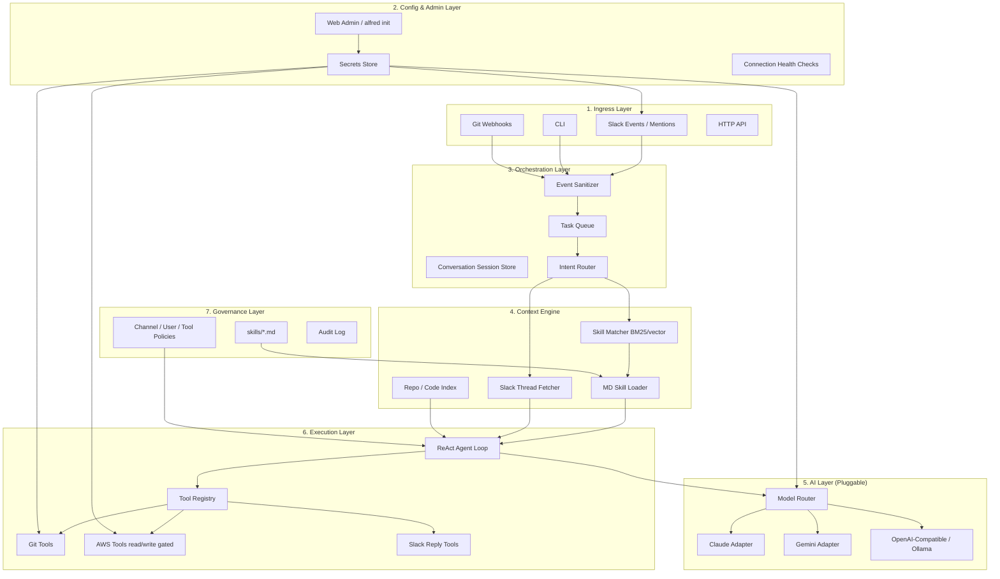
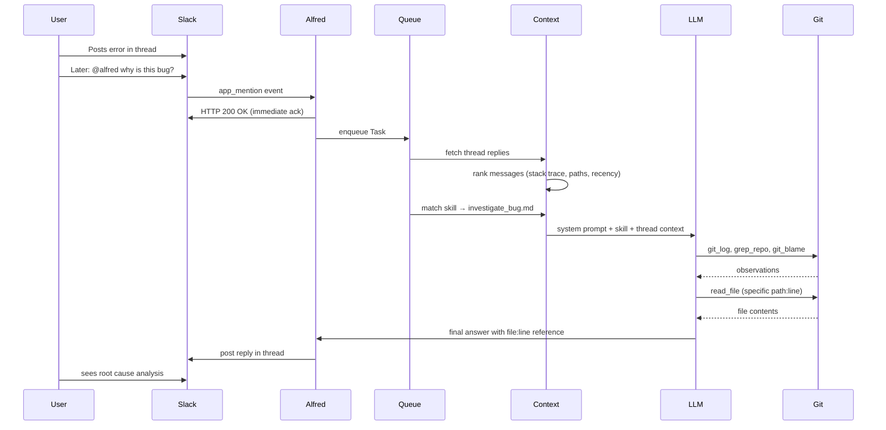

# Alfred v0 — Architecture Evaluation & Layer Plan

> **Status:** Planning document. **Implementation status:** see [`building_phase_v0.md`](building_phase_v0.md) (living tracker — updated 2026-06-21).  
> **Source context:** [`idea.md`](idea.md) (engineering blueprint) + product vision discussion.  
> **Location:** `docs/build-reference/` — planning docs for building Alfred.

---

## 1. Product Vision

Alfred is a **distributable agent for small companies** with a configuration interface. Once it has access to Git, AWS, and Slack, it can:

- Receive commands from Slack (and other ingress points)
- Trigger actions (git ops, AWS queries, deployments, etc.)
- Respond back in the same conversation thread

**Example Slack interaction:**

```
@alfred can you tell where the code is wrong and why this bug exists?
```

After going through relevancy mentioned in the Slack thread or reply, Alfred investigates and responds in-thread.

**Core product pillars:**

1. **Integration hub** — Slack, Git, **JIRA**, AWS as first-class connectors
2. **Governed executor** — skills define *what* it may do; tools define *how*
3. **Distributable product** — small companies install it, configure credentials once, use from Slack

**Non-goals for v0:**

- Multi-tenant SaaS
- Cloud-managed infrastructure on day one
- Arbitrary shell execution without governance

---

## 2. Evaluation of `idea.md`

### 2.1 What It Gets Right

| Principle | Why It Matters |
|-----------|----------------|
| ABC interfaces for Queue, Storage, LLM, Index | Enables plug-and-play providers without rewriting core logic |
| Skill MD files with YAML front-matter | Governance, permissions, and feature extension without code changes |
| Single-skill loading (never dump all skills into context) | Cost control + safety at scale |
| SQLite queue + async worker | Correct pattern for Slack's 3-second ack timeout |
| Tool allowlist per skill | Prevents "LLM runs `rm -rf`" disasters |
| Local-first / zero-ops | Perfect for small companies that don't want infra overhead |
| ReAct agent loop | Standard, proven pattern for tool-using agents |

### 2.2 Gaps Relative to Stated Goals

#### Gap 1: No Configuration Layer

The blueprint has CLI + webhooks but no **setup experience**. Small companies need:

- OAuth / token setup for Slack, GitHub/GitLab, AWS
- Model provider selection (free tier → Claude → Gemini)
- Channel allowlists, skill toggles
- A way to verify "Alfred is connected and healthy"

Without this, "distributable" means "developers who can edit `.env` files."

#### Gap 2: Slack Interaction Model Is Underspecified

The example `@alfred can you tell where the code is wrong…` requires:

- **App mention** handling (`@alfred …`), not just slash commands
- **Thread context ingestion** — fetch parent message + replies, rank by relevancy
- **Reply-in-thread** — responses stay in the conversation
- Possibly **DM vs channel** permission rules

The blueprint mentions "Event Sanitizer" but doesn't describe thread-aware context assembly. That is the hardest part of the "debug this bug" flow.

#### Gap 3: Two Skill Modes, One Architecture

| Mode | Example | Matching | Tools |
|------|---------|----------|-------|
| **Workflow skill** | "cherry-pick hotfix to prod" | Keyword/trigger match → one MD file | Strict allowlist |
| **Investigation skill** | "where is this bug?" | General intent → `investigate.md` or fallback skill | Broader read-only tools (git log, grep, AWS read, Slack history) |

The blueprint only describes workflow skills. The Slack bug question is **investigation mode** — it needs repo access, code search, and reasoning, not a cherry-pick playbook.

#### Gap 4: AI Pluggability Needs a Sharper Contract

"Change from free model to Claude" should mean changing **one config key**, not swapping SDK calls everywhere. That requires:

- A unified `LLMProvider` interface: `complete()`, `stream()`, `tool_call()` with normalized request/response shapes
- Adapters: Anthropic, Gemini, OpenAI-compatible (covers Ollama, Groq, Together, etc.)
- Optional **router** — cheap model for skill matching, expensive model for execution

#### Gap 5: "Distributable" Packaging Is Missing

Small companies expect: Docker Compose, a single binary, or `pip install alfred && alfred init`. The blueprint assumes "clone repo and run Python."

---

## 3. Proposed Layer Architecture



---

## 4. Layer-by-Layer Specification

### Layer 1 — Ingress (How Commands Arrive)

**Responsibility:** Normalize all inputs into a single `Task` object.

```python
Task {
  id: str
  source: "slack" | "cli" | "git" | "web"
  user_id: str
  channel_id: str
  thread_ts: str | None
  raw_text: str           # "@alfred why is this bug happening?"
  cleaned_intent: str     # "why is this bug happening?"
  metadata: dict          # repo hint, error snippet, links
}
```

**Components:**

| Component | Description |
|-----------|-------------|
| CLI Module | `alfred exec <command>` for local iteration and git hook integration |
| Webhook Server | FastAPI instance for Slack events and GitHub/GitLab webhooks |
| Event Sanitizer | Extracts user intent, author ID, channel source; strips bot mention prefix |

**Slack-specific requirements:**

- Subscribe to `app_mention` and optionally `message.channels` in allowed channels
- Ack immediately (HTTP 200), enqueue, process async
- Reply via `chat.postMessage` with `thread_ts` to stay in thread

**From `idea.md`:** CLI + Webhook Server + Event Sanitizer — keep as-is, extend for mentions and thread metadata.

---

### Layer 2 — Config & Admin (The "Small Company" Experience)

This is what makes Alfred distributable.

**V1 options:**

| Approach | Pros | Cons |
|----------|------|------|
| `alfred init` CLI wizard | Fast to build, no frontend | Less friendly |
| Local web UI on `:8080/admin` | Visual, health dashboard | More work |
| Docker Compose + `.env.example` | Standard for self-hosters | Still technical |

**Minimum config surface:**

```yaml
# .alfred/config.yaml (structure TBD)

slack:
  bot_token: ${SLACK_BOT_TOKEN}
  signing_secret: ${SLACK_SIGNING_SECRET}
  allowed_channels: ["#engineering", "#ops-alerts"]

git:
  provider: github | gitlab
  token: ${GIT_TOKEN}
  default_org: acme-corp
  repos: ["backend", "frontend"]   # or auto-discover

aws:
  profile: default
  region: us-east-1
  allowed_services: [cloudwatch, ecs, s3]   # read-only default

ai:
  default_provider: anthropic
  providers:
    anthropic:
      api_key: ${ANTHROPIC_API_KEY}
      model: claude-sonnet-4-20250514
    ollama:
      base_url: http://localhost:11434
      model: llama3
    gemini:
      api_key: ${GEMINI_API_KEY}
      model: gemini-2.0-flash

skills:
  directory: ./skills
  custom_directory: ./skills/custom
  disabled: []
```

**Secrets storage:** encrypted local SQLite or `.alfred/config.yaml` + OS keychain for API keys.

**Health checks:**

- Slack: `auth.test`
- Git: list repos / ping API
- AWS: `sts get-caller-identity`
- AI: minimal completion ping

---

### Layer 3 — Orchestration (Reliability + Conversations)

**Components:**

| Component | Description |
|-----------|-------------|
| Task Queue | ABC `BaseQueue` with `push()`, `pop()`, `ack()`. V1: in-memory + SQLite persistence |
| Session Store | Keyed by `(channel_id, thread_ts)` for follow-up context within a thread |
| Intent Router | Decides: workflow skill vs investigation vs chit-chat vs out-of-scope |

**Intent router logic (V1, simple):**

1. If message matches a skill's `trigger_keywords` → **workflow mode**
2. If message looks like a question / debug request → **investigation mode** (`skills/investigate.md`)
3. Else → polite decline or help message

**Why async queue matters:**

Slack requires a response within ~3 seconds. Pattern:

```
Slack event → HTTP 200 "Acknowledged" → enqueue → background worker → post reply to thread
```

**From `idea.md`:** Task Router & Local Queue — keep SQLite-backed design.

---

### Layer 4 — Context Engine (Slack Bug Question Lives Here)

This layer assembles everything the agent needs before calling the LLM.

**Sub-components:**

#### 4a. Skill Matcher

- Directory watcher on `./skills/*.md`
- Parse YAML front-matter (triggers, permissions, channel locks)
- V1: TF-IDF / BM25 keyword match against `trigger_keywords` + `description`
- V2: optional ChromaDB vector index for semantic matching
- **Rule:** Never load the entire skills directory into the LLM context window

#### 4b. Slack Thread Fetcher

For `@alfred why is this bug…` in a thread:

```
1. Fetch thread history (Slack API: conversations.replies)
2. Extract relevancy signals:
   - Messages mentioning error codes, stack traces, file paths, PR links
   - User who @mentioned Alfred (weight their message higher)
   - Recent messages vs old (recency bias)
3. Optional: if thread links a repo/PR/commit → resolve to local git context
4. Build a ContextBundle:
   - thread_summary (LLM-compressed or rule-based)
   - relevant_messages[]
   - linked_artifacts (commit SHA, S3 log group, etc.)
5. Pass ContextBundle + matched skill to agent loop
```

**Relevancy heuristics (V1, no ML required):**

- Regex for stack traces, file paths (`src/foo/bar.py:42`), error codes
- URL detection (GitHub PR, commit, AWS console links)
- Keyword overlap between user question and thread messages
- Recency weighting (last N messages prioritized)

**Optimization:** Thread context assembly can use a **cheap/fast model** (or heuristics) before the main agent runs. Don't burn Claude tokens on Slack history formatting.

#### 4c. Repo Context

For code investigation:

- Clone or use existing local mirror of allowed repos
- Tools: `git blame`, `git log`, `grep`, read file — all read-only by default
- Optional: lightweight index (BM25 over repo) for "where is X handled?"

#### 4d. Skill Loader

- Reads matched MD file body (Objective, Execution Steps, Governance Rules)
- Injects into system prompt
- Attaches allowed tool schemas

**From `idea.md`:** Index-Driven Context Engine — extend with thread fetcher and repo context.

---

### Layer 5 — AI Layer (Pluggable, Buttery)

**Design principle:** One interface. Everything else is adapters. Adding a new provider = one adapter file + config schema entry. No changes to agent loop.

#### Unified Interface

```python
class LLMProvider(ABC):
    def chat(
        self,
        messages: list[Message],
        tools: list[ToolSchema] | None = None,
        model: str | None = None,
    ) -> LLMResponse: ...

    def stream(self, messages, tools=None, model=None) -> Iterator[LLMChunk]: ...

    def embed(self, texts: list[str]) -> list[list[float]]: ...  # optional, for skill matching
```

#### Adapters to Ship First

| Adapter | Covers | Priority |
|---------|--------|----------|
| OpenAI-compatible | Ollama, Groq, Together, Mistral free tiers, OpenAI | P0 |
| Anthropic | Claude native tool calling | P0 |
| Google GenAI | Gemini native tool calling | P1 |

#### Config-Driven Switching

```yaml
ai:
  default_provider: anthropic
  routing:                        # optional per-task routing
    skill_matching: ollama        # cheap/local
    investigation: anthropic      # capable
    workflow_execution: anthropic # capable + reliable tool calling
  providers:
    anthropic:
      api_key: ${ANTHROPIC_API_KEY}
      model: claude-sonnet-4-20250514
    ollama:
      base_url: http://localhost:11434
      model: llama3
    gemini:
      api_key: ${GEMINI_API_KEY}
      model: gemini-2.0-flash
```

#### Normalization Concerns

Different providers have different tool-calling formats. The adapter layer must normalize:

- Tool call request/response shapes
- System vs user message roles
- Token limits and truncation strategy
- Error handling and retries

**From `idea.md`:** LLMProvider ABC — keep, expand with routing and OpenAI-compat adapter.

---

### Layer 6 — Execution (Tools + ReAct Loop)

**Agent loop:**

```
[LLM generates thought/action]
  → [Tool Runner executes locally]
  → [Output piped back as observation]
  → [LLM processes updated state]
  → repeat until done or max iterations
```

**Prompt assembler injects:**

1. General agent guardrails
2. Matched skill's execution instructions (from MD file)
3. Thread context bundle (if investigation mode)
4. Precise string-defined schemas of allowed tools

#### Tool Registry

Named, schema-defined, permission-gated tools:

| Category | Example Tools | Default Permission |
|----------|---------------|-------------------|
| Git (read) | `git_log`, `git_show`, `git_blame`, `grep_repo`, `read_file` | investigation skills |
| Git (write) | `git_checkout`, `git_cherry_pick`, `git_push`, `create_pr` | workflow skills only |
| AWS (read) | `cloudwatch_query`, `describe_ecs_service`, `list_s3_objects` | investigation |
| AWS (write) | `restart_ecs_task`, `scale_service` | explicit skill + confirmation |
| Slack | `post_thread_reply`, `react_emoji` | all |
| Shell | `run_command` | sandboxed, skill-scoped, heavily restricted |

#### Double-Gated Tool Access

Tool availability is filtered twice:

1. By matched skill's `allowed_tools` list
2. By global policy (e.g., no write AWS in `#general`)

#### Safety Constraints

- Input validation to block forbidden keywords (`rm -rf /`, `delete-stack`, etc.)
- Working directory sandboxing for shell commands
- Max iteration limit on ReAct loop
- Timeout per tool invocation

**From `idea.md`:** Tool Execution Box + Agent Core & ReAct Loop — keep, add investigation read tools first.

---

### Layer 7 — Governance (Skills + Policies)

#### Skill MD Format (Extended from `idea.md`)

```markdown
---
name: investigate_bug
description: Analyze bugs from Slack threads using git and logs
mode: investigation          # workflow | investigation | conversational
trigger_keywords: ["bug", "wrong", "broken", "error", "why", "issue"]
allowed_channels: ["*"]      # or specific channels
allowed_tools:
  - git_log
  - git_blame
  - grep_repo
  - read_file
  - cloudwatch_query
  - slack_reply
requires_thread_context: true
---

# Objective
Analyze the bug described in the Slack thread. Use git history and code search
to identify the root cause. Respond with specific file:line references.

# Execution Steps
1. Read the thread context and identify error messages, stack traces, or symptoms.
2. If a repo/branch/commit is mentioned, check out or inspect that context.
3. Search the codebase for relevant code paths.
4. Use git blame/log to find recent changes that may have introduced the bug.
5. Formulate a root cause hypothesis with evidence.
6. Reply in the Slack thread with findings.

# Governance Rules
- READ-ONLY: Do not modify any code or infrastructure.
- If unsure, state assumptions clearly.
- Always cite file paths and line numbers when referencing code.
```

#### Example Workflow Skill (from `idea.md`)

```markdown
---
name: deploy_hotfix
description: Automatically cherry-picks a commit and opens a hotfix production PR
mode: workflow
trigger_keywords: ["hotfix", "cherry-pick to prod"]
allowed_channels: ["#ops-alerts", "terminal"]
allowed_tools:
  - git_checkout
  - git_cherry_pick
  - git_push
  - create_gitlab_pr
requires_thread_context: false
---

# Objective
Safely cherry-pick a bugfix commit from the development branch into the production release branch.

# Execution Steps
1. Checkout the `main` branch and pull the latest code.
2. Create a new branch named `hotfix/<commit-id>`.
3. Cherry-pick the target commit hash provided by the user.
4. Resolve conflicts automatically if safe, otherwise fail instantly and alert user.
5. Push the branch and open a Pull Request against `main`.

# Governance Rules
- CRITICAL: Never push directly to `main` or `master`.
- If any unit test fails during local verification, abort the process entirely.
```

#### Skill Directories

| Directory | Purpose |
|-----------|---------|
| `skills/` | Shipped with Alfred (investigate, deploy_hotfix, etc.) |
| `skills/custom/` | Company-specific overrides and new skills |

#### Policies (Separate from Skills)

- Who can trigger write operations (user allowlist or role mapping)
- Confirmation required before destructive actions
- Audit log of every tool invocation (who, what, when, result)
- Rate limiting per channel/user

---

## 5. End-to-End Flow: Slack Bug Investigation



---

## 6. Abstract Interfaces (from `idea.md`, Extended)

All major subsystems behind Python ABCs for future cloud migration.

```python
# Queue
class BaseQueue(ABC):
    def push(self, task: Task) -> str: ...
    def pop(self) -> Task | None: ...
    def ack(self, task_id: str) -> None: ...

# Storage
class StorageProvider(ABC):
    def get_session(self, key: str) -> Session | None: ...
    def save_session(self, key: str, session: Session) -> None: ...
    def log_audit(self, entry: AuditEntry) -> None: ...

# LLM
class LLMProvider(ABC):
    def chat(self, messages, tools=None, model=None) -> LLMResponse: ...
    def stream(self, messages, tools=None, model=None) -> Iterator: ...
    def embed(self, texts) -> list[list[float]]: ...

# Index / Skill Matching
class IndexProvider(ABC):
    def match_skill(self, query: str, skills: list[SkillMeta]) -> SkillMeta | None: ...
    def index_repo(self, repo_path: str) -> None: ...

# Tool
class Tool(ABC):
    name: str
    description: str
    schema: dict
    def execute(self, **kwargs) -> ToolResult: ...

# Ingress
class IngressHandler(ABC):
    def parse(self, raw_event: dict) -> Task: ...
    def ack(self, raw_event: dict) -> dict: ...
    def reply(self, task: Task, message: str) -> None: ...
```

**V1 implementations:**

| Interface | V1 Implementation | Future Cloud Variant |
|-----------|-------------------|---------------------|
| BaseQueue | SQLite + in-memory thread | SQS, Redis |
| StorageProvider | SQLite | PostgreSQL |
| LLMProvider | Adapters (see Layer 5) | Same adapters |
| IndexProvider | BM25 / TF-IDF | Pinecone, ChromaDB cloud |
| IngressHandler | Slack, CLI | Same |

---

## 7. Recommended Build Phases (Revised)

| Phase | Focus | Deliverable | Depends On | Status (2026-06) |
|-------|-------|-------------|------------|------------------|
| **0 — Foundation** | Project scaffold, ABC interfaces, config schema, `alfred init` | Installable Python package with config | — | ✅ |
| **1 — AI plug layer** | LLMProvider + 2 adapters (OpenAI-compat + one native) | Swap models via config | Phase 0 | ✅ |
| **2 — Skills engine** | MD parser, matcher, tool registry (read-only git) | CLI: match skill + grep repo | Phase 0, 1 | 🟡 |
| **3 — Slack ingress** | Events API, mention handler, queue, thread reply | End-to-end Slack ack + reply | Phase 0 | ✅ |
| **4 — Thread context** | Fetch replies, relevancy extraction, context bundle | Thread-aware context assembly | Phase 3 | 🟡 |
| **5 — Investigation skill** | `investigate_bug.md` + read tools + agent loop | Core demo: `@alfred` debug in thread | Phase 1–4 | 🟡 |
| **6 — Workflow skills** | Write git tools, governance, confirmation | Hotfix/deploy skills | Phase 5 | ❌ |
| **7 — AWS + admin UI** | AWS read tools, web config dashboard | "Small company ready" | Phase 5 | 🟡 |
| **8 — Distribution** | Docker, docs, health checks | Ship to others | Phase 7 | 🟡 |

**First milestone (proves the vertical slice):** ✅ Shipped — see [`building_phase_v0.md`](building_phase_v0.md).

```
alfred init → configure AI → @alfred in Slack → read-only git investigation in a thread
```

**Also shipped beyond original plan:** JIRA tools, assignee/identity mapping, Graphify, usage cost tracking, GitHub App PR ingress.

Phases 0–5 = demo. Phases 6–8 = product.

### Mapping to Original `idea.md` Roadmap

| Original Phase | Maps To |
|----------------|---------|
| Phase 1: Scaffolding & Abstractions | Phase 0 |
| Phase 2: Context Engine & MD Parser | Phase 2 |
| Phase 3: Tool Execution Box | Phase 2 (read-only), Phase 6 (write) |
| Phase 4: Agent Core & ReAct Loop | Phase 1 + Phase 5 |
| Phase 5: Ingestion Webhooks | Phase 3 + Phase 4 |

**Insertions not in original roadmap:**

- Phase 0: Config layer (`alfred init`)
- Phase 4: Thread context engine
- Phase 7: Admin UI
- Phase 8: Distribution packaging

---

## 8. Key Design Decisions (Resolve Before Building)

| # | Decision | Options | Recommendation |
|---|----------|---------|----------------|
| 1 | Deployment model | Single instance per company vs multi-tenant SaaS | Single instance per company (local-first) |
| 2 | Repo access | Clone on demand vs assume repos on disk | Docker volume mount + optional clone-on-demand |
| 3 | Investigation depth | Git grep only vs embedded code index | Git grep for V1; Chroma index in V2 |
| 4 | Confirmation UX for write ops | Slack reaction ✅ vs explicit "yes, proceed" | Explicit confirmation message in thread |
| 5 | Config UI | CLI wizard vs web admin | CLI wizard for V1, web admin in Phase 7 |
| 6 | Skill matching | Keyword/BM25 vs vector semantic | BM25 for V1 (zero deps), vector optional |
| 7 | Default AI provider | Ollama (free/local) vs cloud | Ollama default for dev; cloud for production |
| 8 | Language/runtime | Python 3.10+ (per blueprint) | Keep Python — best ecosystem for LLM tooling |

---

## 9. Minimal Dependencies (from `idea.md`)

```
fastapi>=0.100.0          # Webhook server
uvicorn>=0.22.0           # ASGI server
pydantic>=2.0.0           # Config validation, task models
google-genai>=0.1.0       # Gemini adapter
anthropic>=0.15.0         # Claude adapter
openai>=1.0.0             # OpenAI-compatible adapter (Ollama, Groq, etc.)
pyyaml>=6.0.0             # Skill front-matter parsing
sqlalchemy>=2.0.0         # SQLite task store, audit log, sessions
requests>=2.31.0          # Slack API, outbound notifications
rank-bm25>=0.2.2          # Skill matching (V1)
chromadb>=0.4.0           # Optional: vector index (V2)
boto3>=1.28.0             # AWS tools (Phase 7)
```

---

## 10. Project Structure (Proposed)

```
backend/
├── cli.py                  # alfred init, alfred exec, alfred serve
├── config_manager.py       # Config loading, validation, secrets
│
├── ingress/
├── orchestration/
├── context/
├── ai/
├── agent/
├── governance/
└── storage/

frontend/                 # React/Vite admin UI
skills/
tests/
docker-compose.yml
Dockerfile
pyproject.toml
.env.example
docs/
    └── build-reference/
```

---

## 11. Security Considerations

| Area | Approach |
|------|----------|
| Secrets | Never in git; OS keychain or encrypted SQLite; env vars for Docker |
| Slack verification | Validate signing secret on every webhook |
| Tool sandboxing | Working directory restrictions; no arbitrary shell by default |
| Write operations | Require explicit skill + channel permission + user confirmation |
| AWS | Read-only IAM policy by default; write ops need separate scoped policy |
| Git | PAT with minimal scopes; SSH key optional; no force push tool |
| Audit | Log every tool invocation with user, channel, timestamp, input, output |
| Rate limiting | Per-user/per-channel limits to prevent abuse |

---

## 12. What "Distributable" Means for V1

A small company should be able to:

1. `pip install alfred` (or `docker compose up`)
2. Run `alfred init` — guided setup for Slack, Git, AI provider
3. Run `alfred serve` — starts webhook server + background worker
4. Expose via ngrok or reverse proxy (or Slack Socket Mode to skip tunneling)
5. `@alfred` in Slack and get responses
6. Add custom skills by dropping MD files in `skills/custom/`
7. Switch AI provider by editing one config key

---

## 13. Open Questions

- [ ] Slack Socket Mode vs HTTP webhooks? (Socket Mode avoids ngrok for small teams)
- [ ] Monorepo vs multi-repo: how does Alfred know which repo a thread refers to?
- [ ] Should investigation skill auto-clone repos, or require pre-configured local paths?
- [ ] Max ReAct loop iterations? (suggest: 10 for investigation, 20 for workflow)
- [ ] How to handle long-running tasks (e.g., deploy pipeline)? Progress updates in thread?
- [ ] Skill versioning: how to update shipped skills without breaking custom overrides?
- [ ] Multi-user concurrency: one worker thread or pool?

---

## 14. Summary

**`idea.md` provides:** execution core — queue, skills, ReAct, tool governance. Solid foundation.

**Extend with:**

1. **Config/admin layer** — so non-developers can run Alfred
2. **Thread-aware context engine** — for the Slack debugging use case
3. **Investigation mode** — alongside workflow skills
4. **Normalized AI adapter layer** — one config flip between Ollama and Claude
5. **Distribution packaging** — Docker + init wizard

**First build target:**

```
alfred init → configure Ollama → @alfred in Slack → read-only git investigation in a thread
```

This proves ingress, pluggable AI, skills, and context in one vertical slice before expanding to workflow skills, AWS, and admin UI.
