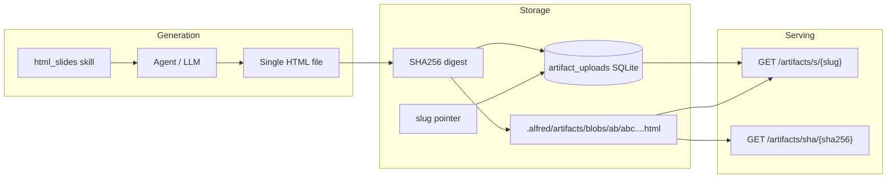

# HTML Slides & Artifact Hosting

Alfred can generate **self-contained HTML slide decks** and host them at stable URLs with content-addressed versioning.

## Architecture



### Content addressing

- Each upload is stored by **SHA256** of the UTF-8 HTML bytes
- Blobs live at `.alfred/artifacts/blobs/{prefix}/{sha256}.html`
- SQLite table `artifact_uploads` tracks metadata and slug → latest mapping

### Slug versioning

| Event | Result |
|-------|--------|
| First upload `redirection-2025` → SHA `100123a...` | `/artifacts/s/redirection-2025` serves `100123a...` |
| Update same slug → SHA `100124b...` | Slug now points to `100124b...`; old SHA still at `/artifacts/sha/100123a...` |

Tracked fields: `uuid`, `sha256`, `slug`, `title`, `uploaded_by`, `uploaded_at`, `size_bytes`, `is_latest`.

## URLs

| Endpoint | Auth | Description |
|----------|------|-------------|
| `GET /artifacts/s/{slug}` | Public | Latest HTML for slug |
| `GET /artifacts/sha/{sha256}` | Public | Immutable HTML by hash |
| `GET /artifacts/assets/*` | Public | Bundled logos/templates |
| `GET /api/artifacts/mine` | Admin + actor | **Your** latest deck per owned slug |
| `POST /api/artifacts` | Admin + actor | JSON body: `{ html, slug, title? }` |
| `POST /api/artifacts/upload` | Admin + actor | Multipart file upload |
| `GET /api/artifacts/{slug}` | Admin + actor (owner) | Latest + version history |
| `GET /api/artifacts/template/slides` | Admin | Reference slide template (herdr snapshot) |

### User-scoped management

- Upload/list/update metadata requires `X-Alfred-User` (display name) and preferably `X-Alfred-Actor-Key` (stable id).
- Admin panel: `admin:{username}` from login.
- Slack: `slack:{user_id}` with display name in `X-Alfred-User`.
- Slug ownership is claimed on first upload; only the owner can publish new versions or view management metadata.
- **`GET /artifacts/s/{slug}` stays public** — share links work without auth.

## HTML slide skill

Bundled skill: `skills/html_slides.md`

- **Self-contained design snapshot** (ink/paper, coral accent, grid, keyboard nav) — no live URL dependency
- Mandatory footers: **Do not distribute without permission** · **Powered by Alfred**
- Reference template: `backend/static/artifacts/slide-template.html`

Enable like any skill in config (not disabled in `skills.disabled`).

## Upload examples

### JSON

```bash
curl -X POST "$HOST/api/artifacts" \
  -H "X-Alfred-Token: $TOKEN" \
  -H "Content-Type: application/json" \
  -H "X-Alfred-User: amit" \
  -d @- <<'EOF'
{
  "slug": "redirection-2025",
  "title": "Redirection Review 2025",
  "html": "<!DOCTYPE html><html>...</html>"
}
EOF
```

### File

```bash
curl -X POST "$HOST/api/artifacts/upload" \
  -H "X-Alfred-Token: $TOKEN" \
  -F "slug=redirection-2025" \
  -F "title=Redirection Review 2025" \
  -F "uploaded_by=amit" \
  -F "file=@deck.html"
```

Share link: `https://<host>/artifacts/s/redirection-2025`

## Slack publish

When a user asks Alfred to **publish/host/share** slides from Slack:

1. The `html_slides` skill routes with a Slack-specific prompt addendum (auto actor, no manual `owner_key`).
2. Alfred calls `publish_html_artifact` — actor is resolved from the Slack task (`slack:{user_id}`, display name).
3. SQLite records `source=slack` and `slack_user_id` on each upload.
4. The Slack reply includes the share URL and “Uploaded via Slack”.

Set `artifacts.public_base_url` in config so share links are absolute in Slack (otherwise relative paths).

## Roadmap (not yet built)

- ~~Admin UI panel for upload/list/preview~~ (v1: **Settings → Automation → HTML slides**)
- Latest slug in the table; **View details** lists older SHA versions with upload time, open/copy, and delete
- ~~Alfred tool `publish_html_artifact` for agents (auto-set Slack actor headers)~~
- ~~Slack publish tracking (`source`, `slack_user_id`)~~
- Theme packs beyond the bundled herdr snapshot (company scripts repo)
- Screenshot/image attachments from Slack → multimodal slide input
- CDN/cache headers on immutable SHA routes

## Files

| Path | Role |
|------|------|
| `backend/db/artifacts_db.py` | SQLite index |
| `backend/artifacts/store.py` | Blob + index writes |
| `backend/api/routes/artifacts.py` | HTTP API |
| `backend/static/artifacts/` | Slide template |
| `skills/html_slides.md` | Agent skill |
